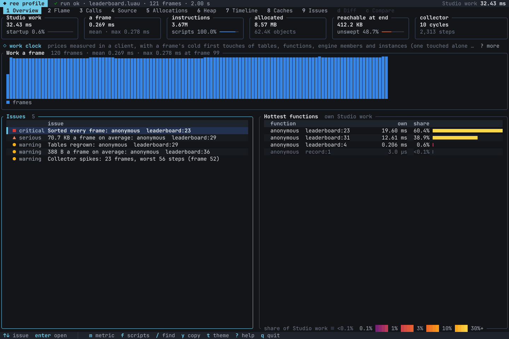
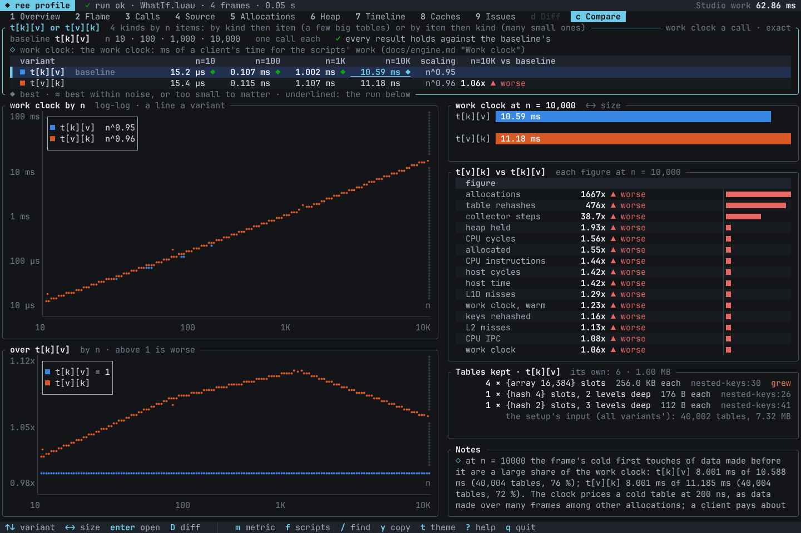

# ree — Emulated Roblox Engine in Rust

`ree` runs Roblox Luau code outside Roblox Studio and the Roblox client. It emulates Roblox instances (using Studio reflection properties, defaults, and events), Roblox datatypes, deferred signals, a virtual-time `RunService` scheduler, standard services (`TweenService`, `Players`, `CollectionService`, `HttpService`, ...), `require` over Rojo project layouts, 3D world queries (CFrames, raycasts, shape casts, particle emits, sounds), and a 3D recorder whose output [ror](https://github.com/Anime-Vanguards/roblox-object-renderer) renders to video.

All Luau executes inside an embedded, patched Luau VM (`mlua`) compiled directly into the Rust crate.

> [!NOTE]
> Nearly all of the code in this repository was written by Anthropic's Claude under maintainer direction. Behavior is verified against Roblox Studio measurements, parity probes, and benchmarks, but Claude wrote almost all of the implementation.

<a href="docs/media/cutscene-1.mp4"></a>

A live game's cutscene executed completely offline. The unmodified cutscene Luau builds the scene and drives cameras, animation tracks, VFX, tweens, and lighting changes inside `ree`; [ror](https://github.com/Anime-Vanguards/roblox-object-renderer) renders the recorded `Workspace` to video. [MP4](docs/media/cutscene-1.mp4).

<a href="docs/media/game-logic-offline.mp4"></a>

The same game's client code running on a match map: a harness walks animated enemies along the track while three units fire their unmodified attack modules at the nearest target. `ree` executed the Luau and recorded the scene; `ror` rendered the frames. [MP4](docs/media/game-logic-offline.mp4).

Additional demo: [second cutscene from the same game](docs/media/cutscene-2.mp4) (4.8 s).

## What it is

`ree` ships both as an embeddable Rust crate (`roblox_engine_emulator`) and as a standalone CLI binary (`ree`):

- **UI renderer foundation:** [roblox-ui-renderer](https://github.com/Anime-Vanguards/roblox-ui-renderer) (`rur`) builds on `ree`, layering GUI layout, text shaping, input, and scene export on top via the engine's extension hooks ([docs/engine.md](docs/engine.md)). (`ree` was extracted from `rur` on 2026-10-10.)
- **Headless 3D recording (`ree record`):** Runs a Luau harness against a project and writes a deterministic scene + timeline recording that `ror` renders as stills or video.
- **Paired client + server (`ree run --run-context loopback`):** Runs a server and its client in a single process with live instance replication and remotes between them ([docs/engine.md](docs/engine.md#loopback-run-context---run-context-loopback-srcloopback)).

Every script-visible behavior is calibrated against Roblox Studio (or follows official Roblox documentation where not yet measured); [docs/engine.md](docs/engine.md) serves as the engine contract.

## Quick start

### Option 1: Install a release binary

Download the zip for your platform from [Releases](https://github.com/Anime-Vanguards/roblox-engine-emulator/releases) and put `ree` on your `PATH`, or install with [Rokit](https://github.com/rojo-rbx/rokit) in `rokit.toml` (Aftman and Foreman also work):

```toml
ree = "Anime-Vanguards/roblox-engine-emulator@0.1.0"
```

> Use Rokit 1.0+ on Linux and macOS. Rokit 0.2.x cannot locate `ree` there because the binary name differs from the repository name.

Need bleeding-edge `main` between releases? Grab `ree-canary-<os>-<arch>.zip` from the nightly [canary](https://github.com/Anime-Vanguards/roblox-engine-emulator/releases/tag/canary) prerelease (untested as a release and may break).

Release binaries run standalone: caches go to `RUR_STATE_DIR`, else `RUR_CACHE_DIR`, else your per-user `ree` cache directory, and `--repo` refers only to input data. `--version`, `--help`, and stateless commands work without a cache folder. See [docs/building.md](docs/building.md#release-binaries) for state paths, requirements, and provenance verification.

### Option 2: Build from source

Requires **Rust 1.90+** and a **C++ toolchain** for the vendored Luau VM ([docs/building.md](docs/building.md)):

```sh
cargo build --release        # Builds target/release/ree(.exe)
cargo test --release         # Runs engine and patched-VM tests
```

### Run your first harness

A harness is a `ModuleScript` returning `function(Context)`. Save this as `Spin.luau`:

```lua
return function(Context)
	local Part = Instance.new("Part")
	Part.Anchored = true
	Part.Size = Vector3.new(4, 1, 4)
	Part.Parent = workspace

	local RunService = game:GetService("RunService")
	RunService.Heartbeat:Connect(function(Dt)
		Part.CFrame *= CFrame.Angles(0, Dt * math.pi, 0)
	end)

	task.wait(Context.Seconds)
	print("done spinning")
end
```

Run it headless or record it for `ror`:

```sh
ree run --harness Spin.luau --seconds 1                                       # JSON status + timestamped output
ree record --harness Spin.luau --out out/spin --seconds 2 --fps 60            # Record scene.rbxm + playback.json
ror video out/spin/scene.rbxm --playback out/spin/playback.json --duration 2  # Render video with ror
```

To run against a Rojo-structured project (`<root>/<Service>/...`), pass `--roots`:

```sh
ree run --harness Probe.luau --roots "game/shared;game/src"
```

Or mount the place a Rojo project file describes (a `DataModel` tree whose `$path`s map folders into services, as roblox-ts and Rojo games have) with `--rojo` ([docs/cli.md](docs/cli.md#engine-options)):

```sh
ree run --harness Probe.luau --rojo default.project.json
```

`ree run` emits structured JSON containing the run status and every output line stamped with its virtual time:


## Profiling Luau performance

`ree run` and `ree record` accept `--profile all` to capture client-priced Luau work per function and source line, allocations, heap snapshots, inline cache stats, and frame-by-frame timelines.

> Note: The interactive terminal viewer (`ree profile view`) and headless screen renderer (`ree profile render`) require building the workspace from source (`ree-profile-view`). Release binaries can still collect full profiles and print text reports via `ree profile report <dir>`.

Try it on the intentionally slow demo harness in [tools/profile-demo/leaderboard.luau](tools/profile-demo/leaderboard.luau):

```sh
ree run --harness tools/profile-demo/leaderboard.luau --seconds 2 --profile all --profile-out out/leaderboard
ree profile view out/leaderboard
```



Use `ree profile try` to benchmark alternative Luau implementations side by side across growing input sizes (examples in [tools/what-if/](tools/what-if)):

```sh
ree profile try tools/what-if/nested-keys.luau      # Writes what-if/nested-keys/
ree profile view what-if/nested-keys
```



Export any viewer tab headlessly to PNG, SVG, or plain text (deterministic across machines—useful for PRs and agents):

```sh
ree profile render out/leaderboard --out view.png
```

See [docs/cli.md](docs/cli.md#the-profile-viewer) for all views, keybindings, and options.

## Documentation

- [Building](docs/building.md) — Release binaries, build requirements, Cargo features, mimalloc, and updating Luau.
- [Command line](docs/cli.md) — `run`, `record`, `serve`, harnesses and `Context`, engine flags, guards, animations, profiling, what-if comparisons, and environment variables.
- [Rust API](docs/api.md) — Embedding `roblox_engine_emulator`, writing custom layers/extensions, and Cargo git dependencies.
- [Engine contract](docs/engine.md) — Internal architecture, Studio-measured rules, recording formats, and known limitations.
- [Verification](docs/verification.md) & [Source layout](docs/layout.md) — Test suites, parity probes, and repository structure.

## Status

Used daily by its maintainers to run UI and VFX code offline, with Windows as the primary development platform. Prebuilt releases are compiled and smoke-tested on Windows `x86_64`, Linux `x86_64`, and macOS `arm64` before publishing. The Rust library API is not yet stable—pin to a release tag or commit.

For gaps and unemulated features (for example, physics beyond free fall and the default `Animate` script), see [docs/engine.md](docs/engine.md#known-limitations) and [docs/cli.md](docs/cli.md#what-is-not-simulated).

## Contributing, security, and license

- **Contributing:** [CONTRIBUTING.md](CONTRIBUTING.md) (coding agents: [AGENTS.md](AGENTS.md))
- **Security & help:** [SECURITY.md](SECURITY.md) · [SUPPORT.md](SUPPORT.md) · [CODE_OF_CONDUCT.md](CODE_OF_CONDUCT.md)
- **License:** GPL-2.0-or-later ([LICENSE](LICENSE)). Compiled binaries bundle third-party components and are distributed under GPL-3.0-or-later; see [THIRD_PARTY_NOTICES.md](THIRD_PARTY_NOTICES.md).

Not affiliated with or endorsed by Roblox Corporation. Roblox, Roblox Studio, and Luau are trademarks of Roblox Corporation.
