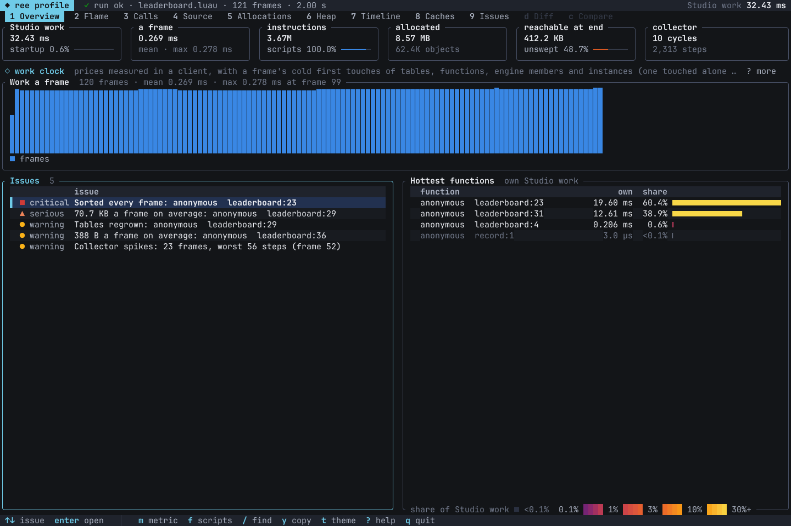
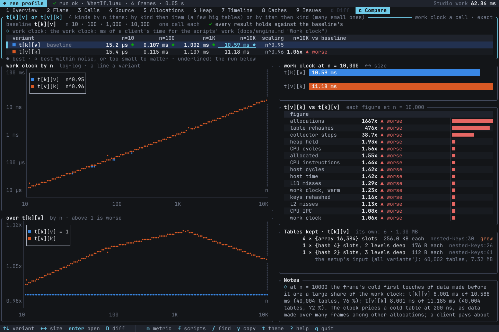

# ree: an emulated Roblox engine

An emulated Roblox engine that runs a game's own Luau outside Roblox: instances with Studio's
properties, defaults and events, Roblox's datatypes, deferred signals, a virtual-time scheduler with
RunService's frame phases, services (TweenService, Players, CollectionService, HttpService, ...),
`require` over a Rojo-layout project, the 3D world scripts see (CFrame views, raycasts and shape
casts, emits and sound plays) and a recorder that writes what a script does to the Workspace as a
scene and a playback [ror](https://github.com/Anime-Vanguards/roblox-object-renderer) draws. The Luau
runs in an embedded, patched Luau VM (mlua), compiled into the crate.

> [!NOTE]
> Almost all of the code here was written by AI: Claude, Anthropic's model, at its maintainers' direction. A lot of
> work went into making it correct, usable and fast for real projects (its behaviour is measured against Roblox Studio
> and checked by tests and benchmarks), but in the end Claude wrote nearly all of it.

<a href="docs/media/cutscene-1.mp4"></a>

A cutscene from a live Roblox game, run offline. The game's own cutscene Luau, unchanged, builds its scene and drives
the cameras, animation tracks, effects, tweens and lighting changes; ree ran it and recorded what it did to the
Workspace, and [ror](https://github.com/Anime-Vanguards/roblox-object-renderer) drew the frames from that recording.
[MP4](docs/media/cutscene-1.mp4).

<a href="docs/media/game-logic-offline.mp4"></a>

The same game's client code on one of its maps: a harness walks a wave of enemies down the track with the game's own
enemy animations, and three units beside it play their own attack modules at the nearest enemy (the harness picks the
target and fades out an enemy once it is hit). ree ran the Luau; ror drew the frames. [MP4](docs/media/game-logic-offline.mp4).

More demos: [another cutscene from the same game](docs/media/cutscene-2.mp4) (4.8 s).

## What it does

It is a Rust crate (`roblox_engine_emulator`) and a command line (`ree`):

- [roblox-ui-renderer](https://github.com/Anime-Vanguards/roblox-ui-renderer) (rur) builds its UI
  previews on it: GUI layout, text measurement, input and the scene export are a layer rur adds
  (see "Layers and extensions" in [docs/engine.md](docs/engine.md)); the engine came out of rur on
  2026-10-10.
- `ree record` runs a harness against a project and writes a recording that ror draws as a video.

Everything script-visible is measured against Roblox Studio or follows Roblox's documentation where it
is not measured yet (the 3D world); [docs/engine.md](docs/engine.md) is the contract and records which.

## Quick start

Download your platform's zip from [Releases](https://github.com/Anime-Vanguards/roblox-engine-emulator/releases)
and put `ree` on PATH, or add this to `rokit.toml`:

```toml
ree = "Anime-Vanguards/roblox-engine-emulator@0.1.0"
```

Use rokit 1.0 or later on Linux and macOS: rokit 0.2.x cannot select `ree` there, because its name differs from the
repository's. The zip also works with aftman and foreman, and `ree --version` prints the installed version.
What a release needs, where it keeps its caches and how to verify it are in
[docs/building.md](docs/building.md#release-binaries).

A release binary is standalone for every job. `--repo` names input data only; state goes to `RUR_STATE_DIR`, else
`RUR_CACHE_DIR`, else the per-user `ree` cache, and the project is the current folder unless `--project` or `--roots`
say otherwise. `--version`, `--help` and stateless commands work without a cache folder.

To build from source, you need Rust 1.90 or later and a C++ toolchain for the Luau VM
([docs/building.md](docs/building.md) has the rest).

```sh
cargo build --release        # target/release/ree(.exe)
cargo test --release         # the engine's tests and the patched VM's
```

A harness is a ModuleScript that drives a run. Save this as `Spin.luau`:

```lua
return function(Context)
	local Part = Instance.new("Part")
	Part.Anchored = true
	Part.Size = Vector3.new(4, 1, 4)
	Part.Parent = workspace
	local RunService = game:GetService("RunService")
	RunService.Heartbeat:Connect(function(Dt)
		Part.CFrame *= CFrame.Angles(0, Dt * math.pi, 0)
	end)
	task.wait(Context.Seconds)
	print("done spinning")
end
```

Then:

```sh
ree run --harness Spin.luau --seconds 1                  # no recording: the status and every output line as JSON
ree record --harness Spin.luau --out out/spin --seconds 2 --fps 60
ror video out/spin/scene.rbxm --playback out/spin/playback.json --duration 2   # with roblox-object-renderer
```

Against a Rojo project, name its roots (`<root>/<Service>/...`): `ree run --harness Probe.luau
--roots "game/shared;game/src"`. The harness can then `require` the game's modules through its
services.

`ree run` prints the run's status and every output line as JSON, with the virtual time each line was printed at:


## Profiling

The terminal viewer needs a source build of the workspace. A release install can generate the same profiles and
read their text summary with `ree profile report <dir>`.

`ree run` and `ree record` take `--profile all`: the Luau's work by function and line, priced as a Roblox client pays
for it, with allocations, the heap, Luau's inline caches and the run frame by frame. `ree profile view` opens a profile
in the terminal, one key per view: a flame graph, callers and callees, each line's cost, allocation sites, the heap, the
timeline, the caches, a before and after diff, and the issues the numbers show. To try it on a leaderboard written the
slow way on purpose ([tools/profile-demo](tools/profile-demo/leaderboard.luau)):

```sh
ree run --harness tools/profile-demo/leaderboard.luau --seconds 2 --profile all --profile-out out/leaderboard
ree profile view out/leaderboard
```



`ree profile try` runs other ways to write the same thing side by side, at growing input sizes
([tools/what-if](tools/what-if) has examples). Here, a table keyed by kind then item against one keyed by item then
kind:

```sh
ree profile try tools/what-if/nested-keys.luau      # writes what-if/nested-keys/
ree profile view what-if/nested-keys
```



`ree profile render <dir> --out view.png` draws any view without a terminal, as PNG, SVG or text and the same on every
machine, for a pull request or an agent to read. Views, keys and options: [docs/cli.md](docs/cli.md#the-profile-viewer).

## Documentation

- [Building](docs/building.md): requirements, the build, cargo features, the allocator.
- [Command line](docs/cli.md): harnesses and their `Context`, engine options, limits, recordings, animation, the warm
  service, profiles and the profile viewer, what-if comparisons, caches, environment variables.
- [Rust API](docs/api.md): embedding the engine, layers and extensions, using the crate from another crate.
- [Engine contract](docs/engine.md): how the engine works inside, its rules and formats, known limitations.
- [Verification](docs/verification.md) and [source layout](docs/layout.md).

## Status

Used daily by its maintainers to run UI and effect code offline. They develop and test on Windows. The
[quick start](#quick-start) installs a release binary; a library host depends on a tag or commit, because the API is
not stable yet. The release workflow builds and smoke-tests Windows x86_64, Linux x86_64 and macOS arm64 on GitHub's
runners, and publishes a release only when every platform passes. Known limitations are in
[docs/engine.md](docs/engine.md#known-limitations). What runs and what does not (physics beyond free fall,
CurveAnimations and the default `Animate` script are not emulated) is in
[docs/cli.md](docs/cli.md#what-is-not-simulated).

## Contributing, security and license

- Contributions are welcome: read [CONTRIBUTING.md](CONTRIBUTING.md) first. AI agents follow
  [AGENTS.md](AGENTS.md).
- Report security problems privately, as [SECURITY.md](SECURITY.md) describes. Questions: [SUPPORT.md](SUPPORT.md).
- Licensed under the GNU General Public License, version 2 or (at your option) any later version
  ([LICENSE](LICENSE)). Vendored and bundled third-party code keeps its own license, and a built binary
  is distributed under GPL-3.0-or-later: see [THIRD_PARTY_NOTICES.md](THIRD_PARTY_NOTICES.md).

Not affiliated with or endorsed by Roblox Corporation. Roblox and Roblox Studio are trademarks of Roblox
Corporation. Luau is a trademark of Roblox Corporation.
