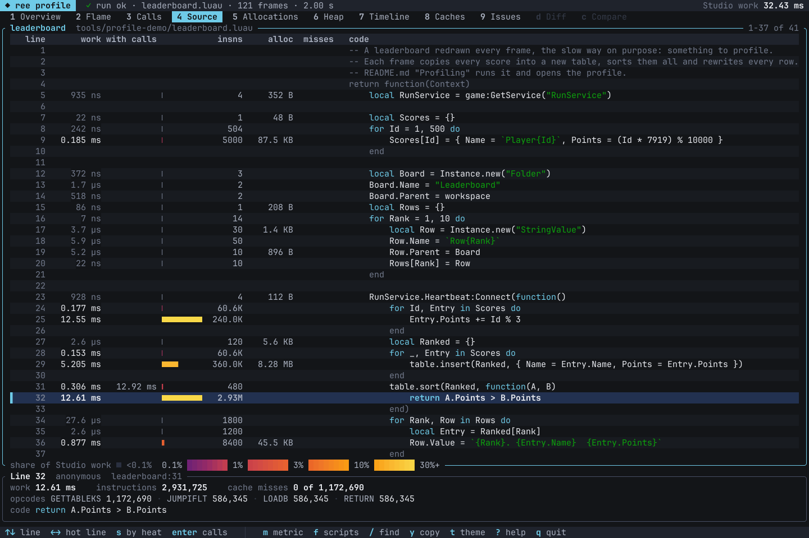

# Command line

`ree record`, `ree run` and `ree serve`: harnesses, options, outputs, the warm service and the environment.
The [README](../README.md) has a first run; [engine.md](engine.md) is the contract behind it.

## Commands

```sh
ree record --harness path/to/Harness.luau --out out/scene --roots "game/shared;game/src" \
    --seconds 3 --fps 60 --context '{"Scenario":"demo"}' --assets-at ReplicatedStorage.Bundles --assets Models \
    [--animations <dir>]                             # pre-fetched KeyframeSequences, <id>.rbxm
ror video out/scene/scene.rbxm --playback out/scene/playback.json --duration 3
ree run --harness path/to/Probe.luau --seconds 1     # no recording: the status and every output line as JSON
ree run --harness path/to/Server.luau --run-context server --seconds 60   # a Play-mode server; `@done` ends it early
ree record --service ...                             # the same, run by the warm service (started when missing)
ree record ... --profile                             # where the time went, on stderr
ree run ... --profile boundary [--profile-out f.json]  # Luau-to-engine crossings per call site, priced (src/boundary.rs)
ree record ... --profile work,alloc,heap [--profile-out dir]  # the profiling suite: summary, JSON, flame graphs, a report page
ree profile diff before/profile after/profile        # two profiles compared
ree profile try tools/what-if/nested-keys.luau       # variants of the same code side by side ("What-if comparisons")
ree profile view before/profile after/profile        # explore one in the terminal ("The profile viewer")
ree profile render out/scene/profile --view all --out shots   # every view as a PNG, for screenshots
ree serve --status                                   # the running services; --stop asks them to exit
ree serve --warm --roots "game/shared;game/src" --assets-at ReplicatedStorage.Bundles --assets Models
                                                     # start the service and read in what a first recording reads
```

## Harnesses

- The harness is a ModuleScript (mounted as `ReplicatedStorage.RURFixtures.<name>`) returning
  `function(Context)` or `{ Run = function(Context) }`. Its own modules are its children: a
  directory named after it beside the file (`Harness.luau` and `Harness/`), or the folder of a
  `Harness/init.luau`, mounts below it as a project directory does, so `require(script.Server)`
  works. It requires the game's modules through
  services, builds what a server would replicate (tagged parts with attributes, a fight folder, a
  floor), connects `RunService` as the game's loops do, and may yield. `Context` has `Seconds`, `Fps`,
  the `--context` object's fields and `StandIn(Module, Source)`, which gives a ModuleScript another
  source before anything requires it (a stand-in for a module the run cannot have; a harness should
  say why in a comment). `Context.Mount(Path, File)` mounts a model file or directory (an absolute
  path) at an instance path as `--mount Path=File` does, from the harness, and returns the instance
  there. `Context.TraceWrites(Properties?, Depth?, Root?)` returns `Drain()`, the Luau call sites
  (`Chunk:line`, innermost `Depth` frames) of every Parent write and every write of the listed
  properties since its last call (a listed `"*"` watches every property and SetAttribute, Kind
  `"attribute"`), for censuses that must name the script behind a Deferred event
  (docs/engine.md). `Context.Census(Depth?)` returns `Take(Collect?)`, a JSON census of what a run
  holds now by the Luau line behind it: live threads by the line that made them (with where each is
  suspended and what will resume it), connections by the line that connected them, handler runs and
  threads made since the last Take, pending task.wait / task.delay / deferred resumptions, and live
  instances by class and top-level parent; printed every N virtual seconds of a long run, it shows
  what accumulates (src/census.rs). `Context.Holders(Filters, Examples?, Requeue?)` names what keeps
  the trees outside the DataModel whose root starts with a filter alive: a property of a live
  instance, queued work, a pin, or the shortest Luau way from a module result, a handler, a thread,
  the globals or the registry (src/lua/holders.rs). `Context.Checkpoint()` marks where a run's setup ends (the game's modules
  required, the world built: what every run with the same arguments does alike) and what is read
  afresh each run begins (the module being worked on); it does nothing to the run, and a service
  prepares the next run up to it (`--service` below). Only its first call, on the harness's own
  thread before the harness first yields, counts. `Context.FrameCheckpoint()` is the same for a setup
  that runs frames (a match server's boot, in a `Prepare`): called on the harness's own thread after
  it first yielded, the harness waits there and the run resumes it before the next frame, in every
  run alike; a service prepares the next `ree run` up to there for the jobs with the same `--fps`
  (and `--frame-times`). `Context.ReseedRandoms(Seed)` restarts every Random alive (one a setup made
  before the run's seed was known included) from Seed and the order it was made in, and returns how
  many it restarted. `Context.SetRandomSeed(Seed)` reseeds math.random and the next unseeded
  Random.new() from then on. `Context.WorkSeconds()` is the script work charged so far in seconds of
  Studio's time, the same however fast the host is. A server run's `Context.SetJoinData(Player,
  JoinData)` gives a fake player, before it joins, the join data a teleport would have carried
  (`TeleportData`, `Members`, ...), which `Player:GetJoinData()` then returns as a fresh copy.
- A harness may split its setup instead: `return { Prepare = function(Context) ... end, Run =
  function(Context) ... end }`. `Prepare` gets a Context with `StandIn`, `Mount` and `Checkpoint` but
  without the `--context` fields, `Seconds` and `Fps`, so it can only do what every run of the harness
  does alike (stand-ins, the game's modules required, the world every scenario shares); where it
  returns is the checkpoint. Then the same Context gets those fields and `Run` goes on with it,
  mounting what the run varies (a character's bundle passed in the context, say) with `Context.Mount`. A
  service's prepared run of such a harness serves every job whose other arguments are the same:
  every character, item and scenario. A `Prepare` that yields prepares nothing.
- Frame 0 is sampled once the harness has started; then the clock runs `--fps` frames a second for
  `--seconds` (`--mode play`, the default: `RunService:IsRunning()` is true, one Heartbeat and one
  render step per frame, `Stepped` fires; `--mode edit` runs the edit-mode clock). A script that prints a
  line that is exactly `@done` ends the run at the end of that frame: the summary's `frames` are the
  frames that ran, and it says `"done": true`.

## Run context

- `--run-context server` runs the scripts as a Studio Play-mode server (docs/engine.md "Server run
  context"): `RunService:IsServer()` true and `IsClient()` false, no local player (Players starts empty;
  a harness parents `Instance.new("Player")`s to it), nothing renders, in-memory DataStoreService,
  MemoryStoreService and MessagingService that start empty every run, and EncodingService (Zstd,
  Base64); `FireClient` / `FireAllClients`
  reach no client and `InvokeClient` waits until its player leaves. It needs `--mode play`. The default,
  `client`, is a playing client with its local player, as before. `--studio false` makes
  `RunService:IsStudio()` false, as on a live game's server or client, so the game takes its live
  branches (TeleportData from `Player:GetJoinData()`, live costs and cooldowns); the default is true.
  It is part of a prepared run's key.
- `--device desktop|touch|gamepad|phone` (or `REE_DEVICE`) is the device the client emulates (UserInputService's inputs;
  desktop by default). `phone` is a touch device whose work clock charges a phone's prices: the desktop prices times a
  sim-to-phone calibration of script time, 2.77 (docs/engine.md "Work clock"): a conversion, not a measurement.

## Engine options

- Options take `--key value` or `--key=value` (the form for a value below zero). Engine options
  (src/launch.rs): `--roots "<dir>;<dir>"` (the project's Rojo roots; without them there is no project,
  only the harness and its mounts), `--project <dir>` (the project's folder) and `--place <name>`;
  `--mount Service/Name=<dir|file>` and `--instance Service/Name=<ClassName>` (repeatable),
  `--snapshot-dir <dir>` / `--snapshot <Service.rbxm>` (Studio exports; the checkout's `data/place-content/<Place>/<parent path>/*.rbxm` replaces a hierarchy snapshot's name-and-class placeholders with the stored instances, no flag), `--run-context client|server`, `--player <name>`,
  `--place-id <n>`, `--streaming <radius>` (the place streams: Workspace.StreamingEnabled and its
  StreamingTargetRadius, as rur.json's `streamingTargetRadius` sets them per root), `--viewport WxH`,
  `--offline`, `--verbose`. Content naming a local file (`file://<path>`, or a path such as
  `output/x.mesh`, as a game's asset id modules can name a mesh or image until it is uploaded:
  CreateMeshPartAsync, CreateEditableMeshAsync, CreateEditableImageAsync) reads a relative path from the
  project's folder: `--project`, else the folder holding the first root, else the current directory (a
  run of mounts alone; through `--service` its client names that as `--project`). `--assets-at
  <Service.Path>` and `--assets <prefix>,...` choose which asset manifest bundles mount where (over the
  project's rur.json `modelAssets`; `*` is every bundle; docs/engine.md "Asset bundles").
  Bundles come from an asset worker, the executable `REE_ASSET_WORKER` names, which downloads
  the assets the manifest pins (docs/engine.md "Asset bundles").

## Limits and guards

- A run cannot outlive its job (src/watchdog.rs). Roblox's script execution timeout: a resumption that runs 10 s of the
  work clock without yielding errors with `Script timeout: exhausted allowed execution time` at its next safepoint in
  script code, and at every one after until it yields or ends, so a `pcall` cannot keep it going. The work clock counts the
  VM's instructions, calls and allocations and the engine calls at Studio's prices, so the timeout fires under
  `REE_FROZEN_CLOCK=1` too, and on a busy machine as on an idle one; 60 s of host time in one resumption fires it as well. `--script-timeout <s>` /
  `REE_SCRIPT_TIMEOUT` (0: off). Each one writes `ree: script timeout <n> at <stack>` to stderr; the third stops the run:
  the frame loop ends it, stdout has the summary (status `error`, the failure names the stack) and ree exits 126
  (`--max-script-timeouts <n>` / `REE_MAX_SCRIPT_TIMEOUTS`, 0: never). A wall-clock cap, 600 s plus 20 s per `--seconds`,
  exits 124 (`--max-wall-seconds <s>` / `REE_MAX_WALL_SECONDS`, 0: off), and ree exits 125 when the process that started
  it is gone, at once when it is gone already (`--no-parent-watch` / `REE_PARENT_WATCH=0`). The `--service` client keeps
  the cap and the parent watch itself; the service's job has the timeout and returns its 126, and lives no longer than
  its client: a job whose client left while it waited (it exited, was ended, or gave up at its cap) is not run, and a
  running one stops before its next frame once its client's connection has closed (exit 125, no files written).
- What a script exhausts is that script's error and the run goes on: past 900,000 threads and values held for scripts
  (mlua's reference stack holds a million) task.spawn / defer / delay and the calls like them raise
  `<call>: too many threads and values held for scripts (...)` at the caller, and waits past 950,000 (docs/engine.md
  "Held values"); HttpService:JSONEncode refuses a cyclic table and nesting past 300 levels, as Roblox does; the command runs on a 64 MiB
  stack, as the service's workers do.

## What a recording holds

- `record` writes `scene.rbxm` (every instance that was ever in the world, as it was when it appeared,
  hidden until then and after it leaves), `playback.json` (ror's playback: appearances and removals,
  `set` actions and keyed tweens, motion tracks, `Emit(n)` / `Clear()` (each emit with where its
  emitter was at the call), moves as `parent`, instance references written after an instance appeared
  as `set` actions naming the referenced instance's path, Lighting),
  `events.json` (prints, warnings, errors, sound plays and stops with their times), `camera.json` and
  `summary.json`, which is also printed on stdout; a `ree: record ...` line goes to stderr.

## Animation

- AnimationTracks play (docs/engine.md "Animation"): `Animator:LoadAnimation` (and the Humanoid's and
  AnimationController's) loads the KeyframeSequence its AnimationId names, and each play-mode frame
  the Animator writes the blended pose into the rig's Motor6D / Bone Transforms. Keyframes come from
  `--animations` directories (`<id>.rbxm` / `.rbxmx`), the download cache (`<state dir>/animations`)
  or the asset worker (its `asset` command); an id
  none of them has is warned about once and its tracks have Length 0. As in Studio, an asset's first
  request in a run arrives 0.45 s later (its tracks keep Length 0 and no pose until then; a later one,
  or one ContentProvider:PreloadAsync waited for, loads at once).
  `KeyframeSequenceProvider:GetKeyframeSequenceAsync` returns a copy of the same KeyframeSequence (it
  raises for an id none of them has). CurveAnimations and the default `Animate` script are not
  emulated.

## What is not simulated

- Nothing else is simulated: particles, trails and beams are what ror draws from the emits and switches;
  physics does not run beyond free fall; spatial queries see Block parts as boxes, Ball parts as
  spheres, Cylinder parts as cylinders and anything else as its oriented bounding box. Rigid joints
  (Weld, Motor6D with its Transform, WeldConstraint, ...) do carry the parts they join, as Roblox's
  kinematics do: moving a rig's HumanoidRootPart moves its body (docs/engine.md, "World and recorder").

## The warm service

- `--service` runs the command in `ree serve`, a warm process of this build and environment that
  keeps the reflection database, the project's module sources and bytecode and the converted
  manifest bundles between recordings (each recording still gets its own engine, VM and
  DataModel; ~0.25 GB private while idle). It runs several recordings at once, so callers sharing it
  do not queue: `REE_SERVE_WORKERS`, else one per 4 hardware threads and per 4 GB of memory, 1 to 4
  (`ree serve --workers <n>` when run by hand); a recording does not start beside others while less
  than 2 GB of memory is free. The client prints what the command prints and exits
  with its code. A lone command runs in its client (a warm service saved a sim nothing measurable,
  and starting one costs ~0.4 s); a command within 10 s of the last one of this build and environment
  (a batch, `@align` passes, parallel lanes) starts the service (detached, from a copy of the binary in `<state dir>/bin`, so cargo can rebuild
  `ree` meanwhile; a newer build replaces it), and the commands after it use it while it runs. It runs in its state dir, not the folder it was started
  from (a process holds its folder: a worktree could not be removed), and exits 20 s after its last
  job (`--idle`; health requests and runs prepared ahead are not jobs; a job whose client has gone stops, so it holds
  no service up: /health counts it `abandoned`). `ree serve --help` lists its options; one it does not know is refused. A service is
  found by its build and by the environment variables a run reads (`RUR_*`, `REE_*`, `ROR_*`), so a
  client with another environment gets its own. Without a reachable service
  the client runs the command itself, as it does for a Luau profile (`RUR_LUAU_PROFILE`). A record
  whose process is gone (a crash, a reboot) is skipped without connecting to it. After a recording
  (or a `ree run`) whose harness called `Context.Checkpoint()`, the worker runs the same command again
  in a fresh engine up to that call and holds it there (src/record/prepare.rs): the next job of that
  command with the same arguments (`--out` and `--profile` aside; for a harness with `Prepare`,
  `--context`, `--seconds` and `--fps` aside too; `--run-context` is one of them, so a client's and a
  server's never share one) goes on from it when everything the run read before the
  call reads the same (the files and listings it read, the project's directories, the wall clock's
  hour), checked while it goes on; else it starts over. It records the same bytes as a recording
  made from the start (a 3 s sim: ~290 -> ~35 ms in the service; with the harness's `Prepare`, for
  every character and scenario). A run is prepared only when jobs like it repeat
  (another started within 10 s, or one waits) and its job read nothing a prepared run cannot check
  before the checkpoint (a mesh, an image: the preparation would fail alike); a preparation that fails
  is not tried again until the next job like it. A worker holds one
  such run (~0.2 GB); one for other arguments is dropped after the next job's reply. An idle worker
  holding nothing prepares the most recent recording too while fewer than two workers hold it, so
  the next job like it finds one ready while the other is prepared again. A job waits for a worker
  still preparing its run only when that is expected ready within 0.2 s; otherwise a free worker
  records it from the start (and then prepares one too). The service listens on 127.0.0.1 only and
  needs an `X-REE: 1` header and a local Host; it has no authentication, so it is a tool for a
  single-user machine (SECURITY.md).
- `ree serve --warm [record's engine options]` starts the service of this build and environment when
  it is missing (run it with the environment the recordings use) and reads in what
  a first recording of the project reads: the last module lists (`record/*.txt`) of the harnesses run
  against this project (their files in its roots or its `external` data roots) read and compiled, the
  plans of the bundles recent recordings of that mount imported, the project scan, the Studio hierarchy
  and Engine.Start; a list whose checkout is gone (its first file's folder is) is deleted on the way.
  It records nothing, writes only caches in the state dir,
  prints a JSON summary (`{"warm":true,"modules":...,"modulesRead":...,"bundles":...,"bundlesRead":...,"seconds":...}`:
  what is ready, and what of it was read now) and exits 0 once
  the service is ready (1 when it could not reach one); the service then idles out as usual. A build
  without it exits 2 with `ree serve: unknown option --warm`.

## Profiles and caches

- `--profile` alone prints where the command's time went on stderr: the mount phases, the harness start,
  module loads, bundle imports, the frames and the files (`prepared: used`, or why a prepared run was
  stale, when a service's worker held one). `--profile boundary` alone is the boundary profiler of before
  (Luau-to-engine crossings per call site, priced; `--profile-out <file.json>`, its folder made when missing).
- `--profile <kinds> [--profile-out <dir>]` profiles the run (docs/engine.md "Profiling"); kinds are
  comma-separated, and a word after `--profile` that names no kind (a misspelt one) stops the command before
  it starts, exit 2, with the kinds listed:
  - `work` (also `instructions`, `lines`): every instruction the VM runs is counted on its own line, and
    what the work clock charges (the instruction's own cost, the engine calls it makes, what it allocates)
    is booked to the instruction that caused it. Per function and per line, self and total: instructions,
    work in milliseconds of Studio time, calls, by opcode; callers and callees; the hottest functions'
    source annotated. Exact, and the same every run of the same code. ree compiles modules at `-O2`, which
    inlines small local functions into their callers: such a function has no frame of its own there, so its
    calls are counted where its inlined copies run, listed under "inlined functions" (docs/engine.md
    "Profiling").
  - `caches`: Luau's inline caches per call site (a table key's or a global's predicted slot, a method's
    slot, a resolved import, a builtin's fast path: hit, miss, slow path) and ree's own caches (member
    atoms and dispatch, datatype values, Instance userdata, require results, module bytecode, spatial
    query solids, bundle plans), with hits, misses and evictions.
  - `alloc`: bytes and counts allocated, by type (table, its storage, function, string, userdata by
    Instance class or datatype, thread and its stack, buffer, function prototypes) and by the Luau stack
    that allocated them. Every allocation is counted by type; stacks are taken for every allocation unless
    `--profile-alloc-step <bytes>` samples them (weighted by the inverse of the chance). And the tables that rehashed to
    grow (a table grows only by rehashing, which moves every key it holds into its new parts): by the stack that made
    them rehash and the stack that made the table, with the keys moved and the parts' bytes before and after (profile.json
    `alloc.rehash`, the summary's "table rehashes").
  - `heap`: a snapshot of what the VM holds at the start, at every `Context.ProfilePhase` mark and at the
    end. Its figures are the reachable heap, what scripts and the engine still hold (what a full
    collection would keep): by type and Instance class, the biggest objects by what they keep alive (their
    dominated size) with the path that holds them, the run's own reachable objects by the stack that
    allocated them. The garbage the collector has not swept yet (what that collection would free) is
    counted apart, by type, and is in none of those figures: how much there is depends on where the
    collector's cycle stood when the snapshot was taken. A snapshot collects nothing. Its reachable tables by the stack
    that made them (`tables` in each snapshot): how many, their bytes (a table with its array and hash parts, and the
    parts apart), their array and hash parts as distributions (slots, those holding a value, least, median, greatest, a
    power-of-two histogram), how many levels of tables each is with the tables it holds, and the rehashes that grew them;
    the summary lists the biggest sites. And the collector's work (steps, cycles, bytes freed, host time).
  - `timeline`: a row a frame: work, host time, instructions, the heap, allocations, the collector,
    live instances, connections and threads.
  - `cpu`: the run thread's CPU cycles, the process's CPU time, page faults and peak memory. Nothing is
    estimated. The CPU's hardware counters are `hw`'s.
  - `hw`: the CPU's hardware counters on the run thread ("Hardware counters" below): instructions, cycles
    and IPC, the L1 data cache's misses, the L2's and the last-level cache's, branch mispredictions and
    their rates; for the run, each thread, each phase and frame, and each Luau function and line.
  - `phases`: the wall-time phases of plain `--profile`.
  - `time`: host time sampled every millisecond at the VM's calls, returns and loop edges (a line's time
    lands on its next safepoint). `boundary`: the boundary profiler, its report in the summary and its data
    in `boundary.json` in the profile's folder.
  - `all`: `work`, `caches`, `alloc`, `heap`, `timeline`, `cpu` and `phases`. `time`, `hw` and `boundary`
    are asked for apart: counting every instruction slows the interpreter several times over, so host time
    and the CPU's counters are read in runs of their own.
- A profile writes, in `--profile-out` (default `<out>/profile` for `record`, `ree-profile` for `run`):
  `summary.txt` (also printed on stderr), `profile.json` (everything), folded stacks for flame graph tools
  (`work.folded` in microseconds, `instructions.folded`, `time.folded`, `alloc.folded` and
  `alloc.counts.folded`, `heap.folded`, `counters.<counter>.folded`), `profile.speedscope.json`
  (speedscope.app) and `report.html`, one self-contained page (hot paths with callers, callees and
  annotated source, a call tree, memory, the timeline, caches, the CPU and its counters). `--profile-top
  <n>` sets the summary's rows; `--profile-phase <a,b|all>` the phases the summary's function tables and
  the boundary profiler report: by default `steady` when the run marked one (`Context.ProfilePhase`), else
  every phase. The summary's tables are the game's code: the harness's own (`--harness` modules are
  mounted under `ReplicatedStorage.RURFixtures`; the engine's `rur.record`, which calls the harness, is
  counted with it) and what it called are set apart, with their total on the
  summary's `reported below:` line and their top functions in a table of their own. Lines are counted for
  the whole run, not per phase. In profile.json each function has `harness` and its figures per phase
  (`phases`, with `harness_self_work_ms`, the part done for the harness's code), and `scope` names the
  reported phases with each side's self work.
  The summary's `engine operations` line counts what the reported phases' scripts asked the engine to do, whatever the
  work clock prices it at (the engine's side of a cast, which the work clock reads lower than a client pays): instances
  cloned (each of a copy), made with Instance.new, destroyed (each of the subtree) and taken into the Workspace; property
  writes, those that changed a value, and among them the moves and resizes of a part in the Workspace and the switches of
  an emitter, beam or trail; pivots of what is in the Workspace, parts bulk-moved, emits and descendant queries
  (`scope.engine` in profile.json: `cloned`, `created`, `destroyed`, `entered`, `writes`, `changed`, `geometry`,
  `toggles`, `pivots`, `bulk_moved`, `emits`, `queries`). They are counted at the engine, so they are every script's,
  the harness's too, and what the engine's own Luau does inside a call it prices whole (a PivotTo's moves) is the call's.
  profile.json's `marks` (each `Context.ProfilePhase` mark) and `end` (the run's end) carry the counts so far, so a
  phase's figures are the difference of two marks': the work clock, host time and the run thread's cycles, instructions,
  the VM's work counters (`vm`: objects, their bytes, table storage, keys rehashed, cold first touches), the allocation
  profile's bytes and objects, rehashes (all, and a script's own: `script_rehashes`, `script_rehash_keys`), the
  collector's steps, cycles, bytes freed and host time, the inline caches' outcomes by kind, and the engine operations
  (`engine`).
- `ree profile diff <before> <after> [--out <dir>]` compares two profile directories: the headline
  figures (the reachable heap at the end, and apart from it the garbage not swept yet), the functions
  whose work, calls, instructions or allocations moved, the lines of modules whose source is the same in
  both, caches, memory by type and the timeline; it writes `diff.txt` (also printed), `diff.json` and
  `diff.html`. When both profiles report the same phases (or both marked `steady`), the headline leads
  with the game's code and the harness's in those phases, and the function tables cover them, the
  harness's functions in a table of their own: a harness's work moves with what it scans, not with the
  game. The headline's `engine:` rows compare the engine operations in the same phases (the whole run when
  the profiles share none): instances made, instances destroyed, property writes, parts moved (by a write
  or BulkMoveTo), pivots and emits. Profiles from before the split are compared whole. `ree profile report <dir>` prints a profile's summary again and
  rewrites its page from its profile.json. `ree profile view` explores one in the terminal and `ree profile render`
  draws its screens to files ("The profile viewer").
- With no profile the engine pays nothing measurable (a thread-local read where each profiler hooks in),
  and a profile changes nothing a script sees: the work clock, os.clock and a recording are the same with
  and without it (it allocates nothing on the VM's heap). A profiled command runs in its own process,
  never through `--service`. `REE_PROFILE=<kinds>` (and `REE_PROFILE_OUT=<dir>`, `REE_PROFILE_COUNTERS=<a,b>`)
  asks for a profile where a command line cannot.
- Caches in the state dir: `animations/` (downloaded animation assets, `<id>.rbxm`; delete a file to
  fetch it again), `model-bundles/` (bundle files as uploaded, `asset-<AssetId>-v<Version>.rbxm`, named by
  the asset version they hold and shared by every project that pins it, and the manifest's catalog: the
  worker starts only for a bundle the manifest pins anew; beside each, its
  converted plan, `<file>.plan`, valid while the conversion is the same (build.rs digests its code and
  data: a rebuild that changes neither keeps it): a run maps it and reads it in place (Windows; the
  pages are the file's, shared by every run reading it) instead of decoding and converting the
  bundle again),
  `record/<harness and project>.txt` (the module files a harness's last run read: the next run reads
  and compiles them on other threads), `model-bundles/recent-*.txt` (the bundles the last run of a
  mount imported, and those of the last run of each scene, a harness with its place and context: the
  next run of the scene decodes them ahead the same way; its first run decodes the mount's), `services/`, `bin/` and `serve.log` (the service). All are guesses that only
  save time: a stale one is noticed and the file is read as usual.

## Hardware counters

`--profile hw` reads what the CPU counted while the run thread ran. A process cannot read the CPU's counters on
Windows (`rdpmc` faults in user mode), and the kernel trace session that can record them needs the system's profiling
right, which an account's ordinary processes never hold (User Account Control takes it out of their token). So a small
Windows service reads them on a profile's behalf (tools/hw-counters):

- **Install it once**, from an elevated PowerShell: `& <checkout>\tools\hw-counters\setup.ps1`. It builds the service
  (a Rust program with no dependencies) in a temporary folder, installs it in `%ProgramFiles%\ree-hw-counters` and
  checks every counter (the probe, below). `-User <name>` installs it for another account, `-Binary <exe>` installs a
  built one, `-Uninstall` removes it.
- **What it grants.** The service runs as LocalSystem holding two privileges only: the system's profiling right and
  folder traversal. It starts on demand and stops itself after a minute with no client. The account it was installed
  for may start it and read its status, nothing else. Its pipe opens only for that account (and SYSTEM), from this
  machine; the client process must run as that account and gets counts for its own threads only, never another
  process's. While a profile counts (30 minutes at most) it runs one kernel trace session of context switches that
  carry the counters' values. On AMD Family 1Ah processors it registers four events with Windows until the next
  restart, through Windows Performance Recorder (`wpr.exe`, part of Windows). No driver is installed and no protection
  is turned off.
- **The counters**: `instructions` (retired), `cycles` (core clock cycles while the thread ran), `branches`,
  `branch-misses` (mispredicted), `l1d-accesses` (loads and stores dispatched to the L1 data cache), `l1d-misses`
  (lines the L1 data cache filled for demand loads and stores), `l2-misses` (of those, lines filled from beyond the
  core's L2) and `llc-misses` (of those, lines filled from beyond the core complex's L3: another complex's cache or
  memory). The four cache counters are AMD Family 1Ah events (event 0x29, and the demand fills by source, event 0x43,
  unit masks 0xFF, 0xFE and 0xDC); the rest are the CPU's built-in sources. Any other name is taken for a Windows
  profile source as `ree-hw-counters sources` (or `wpr -pmcsources`) lists it. The CPU counts six at once:
  `--profile-counters a,b,...` chooses them (default `instructions,cycles,l1d-misses,l2-misses,llc-misses,branch-misses`;
  `l1d-accesses` in place of one of them gives the L1 miss rate). The profile adds IPC, the miss rates the counts allow
  (L2 misses of L1 misses, last-level misses of L2 misses, branch misses of branches) and misses per thousand
  instructions.
- **How it counts.** The kernel records the counters at every context switch, so the service hands back each of the
  process's threads' stretches on a CPU with what was counted in each. The run thread takes a reading (it makes itself
  switch out, about 3 us) at the profile's start and end, when the VM starts, at each frame's start and end, at each
  phase mark, around the engine's own steps (Animator, joints, physics) and at the VM's safepoints once a millisecond:
  the counts between two readings are exact, so the run, its phases and its frames add up. A safepoint's reading books
  what was counted since the one before to the Luau stack it finds, as `time` books host time, so a function's and a
  line's figures are a sample in the same way; what ran before the VM (the mount) and after a phase's last sample get
  frames of their own. A reading's own cost (a few thousand cycles) is counted with the run's: the profile measures it
  at its start and says what share of the run the readings took. The process's other threads are totalled per thread.
  The counters count in user and kernel mode (the interrupts the thread's CPU took meanwhile included), as Windows
  Performance Analyzer's counter tables do.
- **Where it shows**: the summary's hardware counter lines and its top functions and lines by self counts,
  profile.json's `counters` (the run, rates, readings, threads, phases, frames, functions, lines), a folded file a
  counter, the report's CPU tab, and `ree profile diff`'s headline. With `work`, `caches`, `alloc` or `heap` in the
  same run the counts include those profilers' own work (the profile warns).
- **Checking it**: `ree-hw-counters probe` (`%ProgramFiles%\ree-hw-counters\ree-hw-counters.exe probe`) counts
  kernels whose counts are known through the service: a loop of four instructions and a branch an iteration, random
  branches half of which mispredict, loads that hit the L1 data cache, and chases through random cycles of cache lines
  that fit the L1, the L2 and the L3, and fit none. Each counter must count what its name says (exit 0). The L3 chase
  runs three times and its last-level misses are read against the fastest try's own speed: on a busy machine other
  programs push the buffer out of the shared L3, and at memory speed nearly every step must miss it (between L3 and
  memory speed it is not checked). The probe is the client's: a build's own (`cargo build --release --manifest-path
  tools/hw-counters/Cargo.toml`) checks the installed service; a change to the service itself takes effect when
  setup.ps1 runs again.
- Without the service (not installed, counting for another profile, the CPU's counters held by another tool) the run
  goes on and the profile says why. `REE_HW_COUNTERS=mock` counts without it (the run thread's cycle count at each
  reading and fixed shares of it: for tests, never a measurement); `REE_HW_COUNTERS=console` reads from
  `ree-hw-counters serve` run in a console (a pipe of its own; it counts only with the profiling right, so from an
  elevated shell). Windows only.

## What-if comparisons

`ree profile try <file.luau>` measures other ways to write the same thing side by side: every variant at every input
size runs in a fresh engine under the profiler, and one folder holds the profiles and an index of what they show
(`compare.json`), which agents and the profile viewer read. tools/what-if/ has examples (nested keys either way, an
array of records or a record of arrays, string or number keys, closures or methods, appending, a table per frame or one
reused, ways to iterate, Vector3 or numbers) and what they show.

- **The variant file** is a Luau module:

  ```lua
  return {
      title = "t[k][v] or t[v][k]",                  -- optional: the file's name otherwise
      about = "two keys, many values each",          -- optional, one line
      sizes = { 10, 100, 1000, 10000 },              -- the n every variant runs at (default { 1 })
      frames = 1,                                    -- calls of run, one a frame (default 1)
      setup = function(n) return data end,           -- the input; measured as the setup phase, not the run
      variants = {
          ["t[k][v]"] = function(data) return result end,
          ["t[v][k]"] = { setup = function(n) return layout end, run = function(layout) return result end },
      },
      check = function(a, b, n) return a == b end,   -- optional: the baseline's result against another's
  }
  ```

  A variant is a function, run with the file's `setup` (which then defaults to returning n), or `{ setup = ..., run = ... }`:
  its own setup builds its own layout of the input (which the heap figures then show) and `run` uses it. A dictionary of
  variants runs in name order, a list of `{ name = ..., setup = ..., run = ... }` in its own; the first is the baseline,
  which the others are measured against. `check(a, b, n)` gets the baseline's result and another variant's at the same size
  and returns true, or false and a message; `check = true` compares them for deep equality. Results are checked in an
  engine of their own, never in a profiled run; without a check, the summary compares the results' digests.
- **Versions of a module**: `versions = { before = "old/Handler.luau", after = "../src/Handler.luau" }` (or a list of
  `{ name = ..., file = ... }`; paths from the variant file's folder) makes each version of one module a variant, with
  `setup = function(n, Module)` and `run = function(data, Module)` driving it. With `module =
  "ReplicatedStorage/Shared/Handler"` each version stands in for that ModuleScript of the project before anything requires
  it (`Context.StandIn`), so it requires its siblings as the project's own does; without `module` each version is mounted on
  its own. Project options (`--roots`, `--project`, `--place`, `--mount`, and the other engine options above) pass through
  to every run; without them the runs have no project.
- **What runs.** For each variant and size, one profiled run: `ree run` of a generated harness with `--profile all`,
  written to `runs/<variant>/<n>/`, an ordinary profile folder (`ree profile report` and `diff` read it). The harness
  marks three phases, each with a heap snapshot at its mark: `setup` (the variant's setup, in a frame of its own), `run`
  (`frames` calls of run, one a frame, from the second frame after setup's, so that what it touches of setup's data is a
  first touch in its frame) and `after` (the result still held). Every mark carries the run's counts so far (profile.json
  `marks`), so a phase's figures are the difference of two marks'. Host time comes from runs of its own whose only
  profile is the marks' clock (`--profile cpu`): `--rounds` rounds (default 9), each running every variant and size once in
  a fresh process, in a new order each round, with the baseline run twice (an A/A pair: how far two runs of the same code
  differ). Such a run calls run for about `--time-ms` (default 10) ms of warm work, at least three times, on inputs it
  prepares in groups of about 1 MB (what a CPU's L2 cache holds); each group's calls run back to back and only they are
  timed, by the run thread's cycles and the host's clock. With the hardware counter service installed, three more rounds
  of such runs read `--profile hw` alone (a new order each round; the first round's profiles in `runs/<variant>/<n>/hw/`),
  and each counter's figure is the median of its rounds. One more engine runs every variant at every size for the
  check. The profiled runs take `--jobs` (default 4) processes at a time; the timed ones run one at a time.
- **Options**: `--out <dir>` (default `what-if/<file name>` here; a folder holding anything a comparison does not write
  is refused), `--sizes a,b`, `--variants a,b` (some of them, the first the baseline), `--frames <n>`, `--rounds <n>`,
  `--time-ms <ms>`, `--jobs <n>`, `--no-time`, `--no-hw`, `--no-check`, `--keep-timed` (keep the timed runs' profile
  folders in `timed/`), `--script-timeout <s>`, and engine options. Exit 0 when every run finished and every check held,
  1 otherwise (compare.json is written either way), 2 for a command line it cannot read.
- **Which numbers are exact.** The work clock (with and without its cold first touches), instructions, allocations
  (bytes and count), the reachable heap, the collector's steps and bytes freed (it paces itself by the scripts' work),
  table shapes, rehashes, cold first touches and inline cache counts are the same in every run of the same code: one
  profiled run is enough, and any difference between variants is theirs. Host time and hardware counters are measured.
  Host time is each variant's fastest round, since whatever else runs on the machine only ever slows a round (a shared
  machine's scheduler can slow whole stretches of rounds several times over, which moves medians and round-by-round
  wins); a variant wins on it only where its fastest round is faster by more than the A/A pair's fastest rounds differ,
  3 % at least, and its median round agrees. On a counter (the median of its rounds: a core's own cycles, which such
  slowing hardly moves), only where it won every round, by 5 % or more. The collector's host time comes from the profiled run
  (its profilers slow it) and is a guide, not a measure.
- **The summary** (`compare.txt`, also printed): the check; a table of each variant at each n by the main figures; the
  setup's cost; the exponent of each figure against n; at the largest n the best variant on each figure with every other
  variant's figure over it (host time with the rounds it won), the figures where they are about equal or within noise;
  the tables each variant's run left, by the line that made them (count, array and hash parts, levels, bytes each, the
  rehashes that grew them); then notes (where the work clock's model bears on the comparison: cold first touches of data
  made before the frame, a gap host time sees and the work clock does not; the collector; failed runs), what is exact and
  what measured, and the fidelity line.
- **Files**: `compare.json` (below), `compare.txt`, `runs/<variant>/<n>/`, `diff/<variant>/` (`ree profile diff` of the
  baseline's profile and the variant's at the largest n) and `harness/` (the generated harness and each run's context).

### compare.json

```jsonc
{
  "format": "ree-what-if", "version": 1,
  "title": "t[k][v] or t[v][k]", "about": "...", "file": "<the variant file>", "out": "<this folder>",
  "command": "<the command line>",
  "baseline": "t[k][v]",
  "variants": [{"name": "t[k][v]", "slug": "t-k-v", "kind": "function", "source": "ReplicatedStorage.WhatIf.tkv:12", "file": null}],
  "sizes": [10, 100, 1000, 10000],
  "frames": 1,
  "module": null,
  "fidelity": "fidelity: ...",
  "metrics": [{"key": "work_ms", "label": "work clock", "unit": "ms", "better": "lower", "exact": true, "per_call": true, "about": "..."}],
  "runs": [{
    "variant": "t[k][v]", "size": 10, "status": "ok", "error": null,
    "profile": "runs/t-k-v/10", "hw_profile": null,
    "digest": "9f3c0a21", "check": {"ok": true, "message": null},
    "setup": {"work_ms": 0.004, "insns": 120, "host_ms": null, "...": 0},
    "run": {"work_ms": 0.002, "warm_ms": 0.0011, "host_ms": 0.0011, "...": 0},
    "host": {"ms": [0.0011, 0.0012], "cycles": [5200, 5310], "rounds": [0, 2], "reps": 2500, "group": 133},
    "hw": {"hw_instructions": [4100, 4102, 4100], "...": [], "rounds": [0, 1, 2]},
    "heap": {"before": 1052672, "after_setup": 1060864, "after_run": 1061888},
    "tables": {"count": 3, "bytes": 1312, "setup": {"count": 1, "bytes": 560}, "run": {"count": 2, "bytes": 752},
               "sizes": {"table": 48, "slot": 16, "node": 32}, "sites": [{"...": "a site, below"}]},
    "hot": [{"key": "...", "name": "build", "module": "...", "line": 14, "work_ms": 0.0018, "insns": 98, "calls": 1}]
  }],
  "scaling": [{"variant": "t[k][v]", "metric": "work_ms", "exponent": 1.01, "r2": 0.999, "last": 1.0,
               "points": [[10, 0.002], [100, 0.019]]}],
  "functions": [{"variant": "t[k][v]", "key": "...", "name": "build", "module": "...", "line": 14,
                 "exponent": 1.98, "r2": 0.99, "points": [[10, 0.0004], [100, 0.04]]}],
  "winners": [{"metric": "host_ms", "size": 10000, "winner": "t[k][v]", "value": 3.3, "runner_up": "t[v][k]",
               "ratio": 1.77, "vs_baseline": null, "clear": true, "material": true, "rounds": {"won": 9, "of": 9},
               "ranking": [{"variant": "t[k][v]", "value": 3.3, "ratio": 1.0, "clear": false, "rounds": null},
                           {"variant": "t[v][k]", "value": 5.8, "ratio": 1.77, "clear": true, "rounds": {"won": 9, "of": 9}}]}],
  "aa": [{"size": 10, "ratio": 1.02, "min_ratio": 1.01, "spread": 0.03, "first_ms": [0.0011, 0.0012], "second_ms": [0.0012, 0.0011]}],
  "host": {"rounds": 9, "time_ms": 10, "reps": [[10, 2500]], "groups": [[10, 133]]},
  "hw": {"read": true, "why": null, "rounds": 3},
  "check": {"ran": true, "ok": true, "failures": []},
  "diffs": [{"variant": "t[v][k]", "size": 10000, "dir": "diff/t-v-k"}],
  "notes": ["..."],
  "seconds": 18.4
}
```

- `variants[].slug` is the variant's folder name; `kind` is `function` or `module` (a version); `source` is where it is
  defined (a function: its chunk and line; a version: the file as the variant file names it) and `file` a version's
  file. `metrics` lists every figure a phase can carry, in the order a table shows them: `label`, `unit` (`ms`, `count`,
  `bytes`, `ratio`), `better` (`lower`, `higher`, or `none` for a figure that names no winner), whether it is `exact`
  (above) and whether a run's figure is `per_call`.
- `runs[]`: one per variant and size. `status` is `ok`, `error` (the variant raised: `error` says in which phase and
  where) or `failed` (the run did not finish). `profile` and `hw_profile` are folders relative to this one. `digest` is a
  hash of the result's contents (keys sorted), equal for equal results; `check` is null when nothing was checked. `setup`
  and `run` hold the figures of their phase by metric key, null where not measured; run's are per call (the phase's
  totals divided by `frames`) where the metric says `per_call`:
  - `work_ms` the work clock (ms of a client's time, docs/engine.md "Work clock") and `warm_ms` the same without the
    frame's cold first touches (what the work costs with its data in the CPU's caches: a client's figure for data made
    together lies between the two); `insns` instructions; `alloc_bytes` and `allocs` what the VM allocated (bytes of
    objects, table parts and stacks; collectable objects); `heap_bytes` the reachable heap at the phase's end beyond its
    start (what the phase still holds); `gc_steps`, `gc_freed` (bytes) and `gc_ms` the collector's work; `cache_hits`,
    `cache_misses` (misses and slow paths) and `cache_hit_rate` Luau's inline caches; `cold_tables` and `cold_ms` the
    frame's first touches of tables made before it and the work they were charged; `rehashes` and `rehash_keys` the
    rehashes a script's own instructions made tables do to grow, and the keys they moved; `host_ms` (the fastest round),
    `host_ms_median` and `host_cycles` (the fastest round, the run thread's reference cycles) from the timed runs; `hw_instructions`, `hw_cycles`,
    `hw_ipc`, `hw_l1d_misses`, `hw_l2_misses`, `hw_llc_misses` and `hw_branch_misses` from the hw run.
  - `host`: the timed runs' figures a call, one per round whose run finished (`rounds` names those rounds: a failed run
    leaves its round out), the calls a timed run made (`reps`) and how many it prepared and ran at a time (`group`).
    `hw`: each counter's figure a call, one per round of the counters' runs that finished, and `rounds` (empty when they
    were not read).
  - `heap`: the reachable heap (bytes) at the setup mark, the run mark and the after mark.
  - `tables`: the tables setup and run allocated that are still reachable after the run (the result held), by
    allocation site, largest first, with the totals of each phase's and the bytes of a table, an array slot and a hash
    node. A site: `{"site": "tkv:14 < tkv:30", "frames": [{"module": "ReplicatedStorage.WhatIf.tkv", "name": "build",
    "line": 14, "path": "<file>"}], "phase": "run", "count": 10000, "bytes": 1760000, "header_bytes": 480000,
    "array_bytes": 0, "hash_bytes": 1280000, "array": {"slots": 0, "used": 0, "min": 0, "median": 0, "max": 0, "hist": [[0,
    10000]]}, "hash": {"slots": 40000, "used": 40000, "min": 4, "median": 4, "max": 4, "hist": [[4, 10000]]}, "levels":
    {"min": 1, "median": 1, "max": 1, "hist": [[1, 10000]]}, "rehashes": 30000, "rehash_keys": 60000}`. `frames` are the
    site's Luau frames, innermost first, without the harness's; `bytes` is each table with its array and hash parts as the
    VM counts them (gcinfo); a part's `slots` is its size summed over the site's tables and `used` the slots holding a
    value; `hist` is `[[upper, tables]]` over power-of-two buckets (a part of 3 slots counts under 4); `levels` is how many
    levels of tables a table is with those it holds (1: it holds no table; tables in a cycle share a level; a metatable is
    not held); `rehashes` and `rehash_keys` count the rehashes of the site's tables over the run (any line's) and the keys
    they moved.
  - `hot`: the functions with the most work in the run phase (its part of the call tree), the harness's left out.
- `scaling`: per variant and metric, the exponent k of a least-squares fit of the figure against n (`c * n^k`, sizes
  with a figure above zero) with its r², `last` the exponent between the two largest sizes (a constant overhead bends the
  fit at small n; the last pair shows the trend), and the points. `functions`: the same for the hot functions' work,
  matched across sizes by their key.
- `winners`: per metric with a `better` and size, the variant with the best figure, the runner-up, `ratio` (the
  runner-up's figure over the winner's, the other way for `better: higher`; null when only the runner-up is above 0) and
  `vs_baseline`; `ranking` every variant from the best, each with its figure over the best's and whether that gap is
  `clear`: an exact figure by 1 % or more, host time by the rule above (`rounds`: the rounds it won, of those both ran), a hardware counter when it won every round by 5 % or
  more (`rounds` too). `clear` at the top is the runner-up's. `material` is false for a count too small to matter beside the run's work
  (under a thousandth of its instructions, or 10) and for bytes under 1 KB; such a winner is no finding. `aa`: per size,
  the A/A pair's median ratio round by round (the second run over the first), `min_ratio` the ratio of their fastest
  rounds (the host-time rule's noise), `spread` the relative interquartile range of the round-by-round ratios, and both
  runs' figures in the rounds where both finished. `host`: the timing's settings and the calls
  per size. `check.ok` is there only when something was checked (`ran`); fields with no value are null, but `about`, a
  frame's `path` and the samples' lists hold no nulls.
- `notes`: what to keep in mind reading this comparison: where the work clock's model bears on it (a large share of
  cold first touches, a gap host time sees and the clock does not), rounds the machine slowed (twice a variant's fastest
  or more), the collector's work, failed runs and checks, why the hardware counters were not read.

## The profile viewer

`ree profile view <dir> [<dir2>]` opens a profile in the terminal: one profile, a before and after pair, or a what-if
folder (`compare.json`). `ree profile render ...` draws the same screens headless to a PNG, an SVG or text. Both only
read profile folders. They run `ree-profile-view`, a binary of its own beside `ree` that `cargo build --release` builds
with it (profile-view/, on ratatui: the engine's crate has no terminal UI). Each view is panels with rounded borders,
tables with their header raised and every other row shaded, charts and gauges; the panel that takes the keys has its
border in the accent.



- **What it opens**: a profile folder (it holds profile.json), the folder of a run made with `--profile` (profile/ in
  it), or a what-if folder. Two folders are a pair, before and after, and open on Diff. A what-if folder opens on
  Compare, with the baseline's run at the largest size open in the other views.
- **Views**, a key each:
  - `1` Overview: the run's totals (the mount's work apart from a frame's), the work clock's fidelity line, the run
    frame by frame, the issues and the hottest functions in the phases the profile reports (its `scope`: as the
    summary's tables, `--profile-phase`, by default steady when the run marked one, else every phase). The game's code
    leads, and the harness's own code (under ReplicatedStorage.RURFixtures, and the engine's `rur.record` that calls it,
    with the C functions, the engine's Luau and mlua's helpers they called) comes in a panel of its own, with a card for
    the two sides' work; a run whose code is all the harness's (under 1% on the game's side: code measured by
    `--harness` alone) is shown whole. A line under the fidelity line counts what those phases' scripts asked the
    engine to do (instances cloned, made, destroyed and taken into the Workspace, property writes and the moves among
    them, pivots, bulk moves, emits, queries: profile.json's marks, from ree 64fb6e6), every script's, the harness's
    too: the engine's side of a cast, which the work clock reads lower than a client pays.
  - `2` Flame: the call tree as an icicle, the run at the top; each node as wide as its total and coloured by its own
    share. It opens on the run's heaviest phase; down follows the heaviest callee, enter zooms into a node, esc comes
    back out.
  - `3` Calls: a function between its callers and its callees, what it cost under each, and its hottest lines.
  - `4` Source: a module's lines with their heat, instructions, allocations and Luau cache misses, and the selected
    line's opcodes.
  - `5` Allocations: the sites (the Luau line that allocated), their bytes, objects, object size, bytes a frame in the
    steady state and types, and each site's stacks.
  - `6` Heap: the reachable heap at each snapshot, the biggest holders and what they keep alive, the heap by type, the
    run's own objects still reachable by allocating stack, and the collector.
  - `7` Timeline: a column a frame, by phase; pick a frame to see each of its figures beside its phase's median frame,
    and each figure frame by frame.
  - `8` Caches: Luau's inline caches by kind and by call site, and ree's own.
  - `9` Issues: what the profile's numbers show to fix (below).
  - `d` Diff, of a pair: the headline figures, then the functions, lines and allocation sites that moved. When both
    profiles report the same phases, or both marked steady, it leads with the game's code and the harness's in them,
    and the functions' work covers those phases, the harness's functions last and greyed, as `ree profile diff`. The
    engine's counts in the same phases follow (instances made and destroyed, property writes, parts moved, pivots,
    emits), in ree profile diff's groups.
  - `c` Compare, of a what-if folder: each variant at each size in the comparison's metric, how it grows with n (a
    log-log plot, a line a variant) and each variant over the baseline by n, the best of each size, each variant's
    figure at the selected size as bars, every figure of a variant over the baseline's (worse to the right, on a log
    scale; a figure that names no winner, as `better` "none", as it is, in no colour), and the variant's own table
    shapes (its run's, the setup's input apart). A winner that is clear and material is marked ◆, one within noise or
    too small to matter ≈. Enter opens the run in the other views, `D` diffs it against the baseline's.
- **Keys**: arrows or hjkl move, enter goes in, esc or backspace comes back out; `m` and `M` the metric (Studio work,
  host time, instructions, allocated bytes, allocations, Luau cache misses, each hardware counter the profile read);
  `s` sort; `f` scripts only (C functions and the engine's own Luau fold into the script that called them); `/` search,
  `n` and `N` the next and previous match; `y` copy the selected name or path (through the terminal); `x` the other
  side of a pair; `t` light or dark; `?` help; `q` quit.
- **Colour**: one heat scale for a figure's share of the run, through several hues as inferno's (purple at 0.1 %,
  crimson, orange, gold at 30 % and more on the dark theme; the same turned round on the light one, so more is always
  further from the page; its lightness steps evenly, so the order reads in grey and under colour blindness), grey
  under 0.1 %, its legend along the bottom of the panels that use it; red ▲ and blue ▼ for more and less than before;
  a colour a variant or phase, in the data-viz palette's fixed order; an issue's severity as an icon and a word.
  24-bit colour where the terminal shows it, else each colour's nearest of the 256 every terminal has
  (`REE_VIEW_COLOR=truecolor|256` decides). Screenshots are always 24-bit.
- **Issues** come from measured patterns only, each with its numbers and a link (enter) to the view and line that show
  it: `table.sort` about once a frame or more in the steady state (the last phase holding most of the frames); a site
  that allocates through the steady state, or in bursts (more a frame on average than some frames allocate in all);
  tables regrown (table storage allocated past their first); collector and frame spikes; connections, instances or
  threads that keep growing; the reachable heap growing; an inline cache that misses; a property read again in the
  same frame, and writes that change nothing (the boundary profile's, `--profile boundary`); in a comparison, cost that
  grows faster than n and a variant whose result differs. The issues cover the game's code: what the harness's own code
  sorts, allocates, misses or reads again is left out (unless the run's code is all the harness's), and a frame spike
  says how much of the harness's work the frames hold. What the profile's kinds cannot show is listed as not checked.
- `ree profile render <dir> [<dir2>] --out <file|dir|-> [--view <name>|all|<a,b>] [--metric <m>] [--select
  <function|file:line>] [--keys "<keys>"] [--size <cols>x<rows>] [--theme dark|light] [--scale <n>] [--format
  png|svg|txt]` draws exactly what the terminal shows at that size (default 160x48), the same on every machine:
  `--out x.png` (the cells rasterized with the bundled JetBrains Mono, 9x20 pixels a cell at `--scale 1`), `.svg` or
  `.txt`. A folder takes a file a view (`--view all`: every view the input has, `<folder>/<view>.png`), and `-` prints
  text. `--select` picks a function by its name, or a line as `Module:line` or `file.luau:line`, before anything is
  drawn; `--keys` then plays keys as typed (`"2 down enter"`: the Flame, down its heaviest callee, zoomed in; named
  keys enter, esc, backspace, up, down, left, right, pgup, pgdn, home, end, tab, backtab, space; `/text` searches). It
  prints each file it wrote, a PNG with its Markdown image line.
- **For agents**: `ree profile render <dir> --view issues --out -` is the quickest read of what to fix; `--view all
  --out <folder>` gives a screenshot of every view in one command, and the printed Markdown line shows a PNG to the
  user. To show one finding, `--select` its function or line and render the view its issue links to (Calls for a
  function, Source for a line, Allocations for a site, Timeline for a frame).

## Environment

Environment (the variables keep the names they had in rur, whose tools set them; `REE_PROFILE`, `REE_PROFILE_OUT` and
`REE_PROFILE_COUNTERS` are the profile's, above, and `REE_HW_COUNTERS` its counters' source; the guards' `REE_SCRIPT_TIMEOUT`,
`REE_MAX_SCRIPT_TIMEOUTS`, `REE_MAX_WALL_SECONDS` and `REE_PARENT_WATCH` are above; docs/engine.md "Environment"
lists them all): `RUR_STATE_DIR`
(caches; default `.cache`), `RUR_VERBOSE=1` (script output on stderr), `RUR_ENGINE_TIMINGS=1` (mount
phases), `RUR_ENGINE_DUMP=<file>` (every instance after the mount), `RUR_EPOCH` (the wall clock's start),
`RUR_CLOCK` (a recorded Studio clock), `RUR_CAMERA`, `RUR_PLACE_ID`, `RUR_PLAYER`, `RUR_PLAYER_ID`,
`RUR_PLAYER_DISPLAY`, `RUR_ROTATION_CLIPPING`, `RUR_PROFILE_CALLBACKS`, `RUR_LUAU_PROFILE=<file>` (the
Luau VM's sampled stacks, folded; `RUR_LUAU_PROFILE_CLOCK=work` samples the work clock's charges
instead of host time, `RUR_LUAU_PROFILE_UNIT=us` writes microseconds), `RUR_LUAU_ALLOC_PROFILE=<file>` (bytes the VM allocates by Luau stack,
folded, with the allocation counts in `<file>.counts`; a native function's allocations end the stack in it;
`RUR_LUAU_ALLOC_STEP=<bytes>` sets the sampling step, default 1024, 1 records every allocation; a harness
names the phase of both profiles with `Context.ProfilePhase(Name)`; see src/luau_profile.rs),
`REE_LOCALIZED_PLACES` / `REE_MATCH_PLACES` (places whose clients pay a localization lookup of their own on Text
writes, or more for part geometry writes: docs/engine.md "Work clock").
