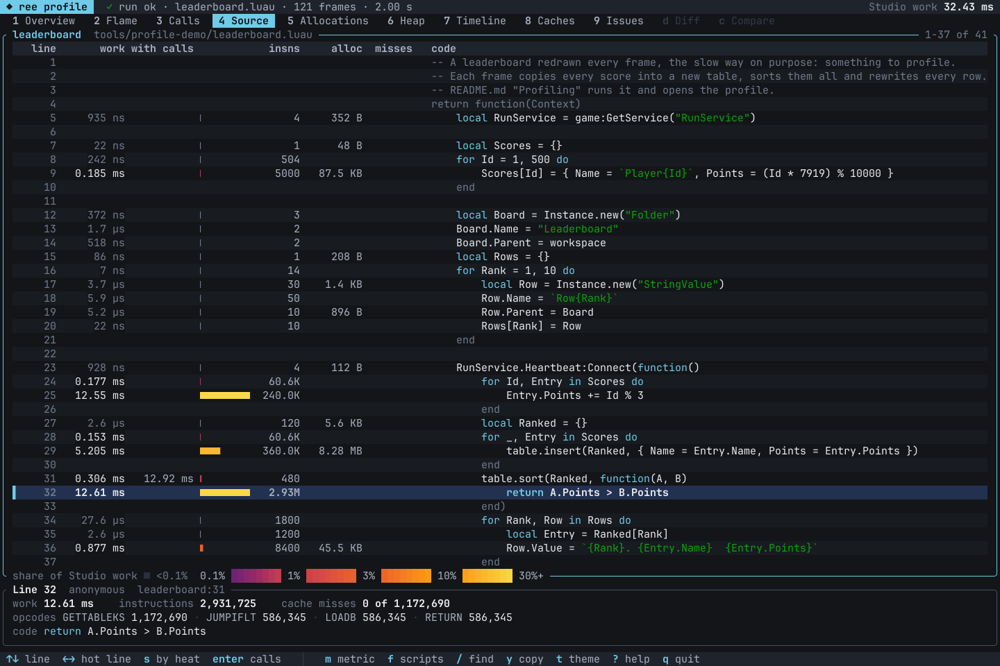

# Command-line reference (`ree`)

Complete CLI reference for `ree run`, `ree record`, `ree serve`, and `ree profile` (`diff`, `report`, `try`, `view`, `render`). For a quick first run, see the [README](../README.md); for internal behavioral rules, see [engine.md](engine.md).

Run `ree --version` to print the build version, or pass `--help` / `-h` (also after `run` or `record`) for usage.

## Release install vs. source build defaults

An installed [release binary](building.md#release-binaries) runs standalone:
- Never implicitly reads `.env`, checkout snapshots, or local place data from the current directory or binary directory.
- Resolves the project from `--project`, else the folder of the `--rojo` file, else the parent of the first `--roots` entry, else the current directory. `--repo <dir>` supplies input data only (never relocating caches to `<dir>/.cache` or selecting host mode).
- Stores caches in the per-user `ree` cache directory (`RUR_STATE_DIR` or `RUR_CACHE_DIR` overrides; `serve --state-dir <dir>` overrides for a service and its workers). Environment paths (`RUR_CLOCK`, `RUR_ENGINE_DUMP`, etc.) resolve relative to the client's current directory before starting a standalone service.
- Writes unnamed profiles to `<state dir>/ree-profile`, boundary profiles to `<state dir>/ree-boundary.json`, `profile try` output to `<state dir>/what-if/<file>`, `profile diff` / `profile report` defaults to `<state dir>/ree-profile`, and spooled script output to `<state dir>/output` (deleted on exit). Explicit `--out` paths are used verbatim, and recording profiles stay inside the recording's output directory.
- `--version` and `--help` require no cache; commands that write files check state first and ask for `RUR_STATE_DIR` if no cache location exists.
- `profile view` and `profile render` require the separate `ree-profile-view` binary from a workspace source build. Manifest bundles require `REE_ASSET_WORKER`.

Source checkout builds and library hosts keep their checkout-local `.cache` and host defaults.

## Commands

```sh
ree record --harness path/to/Harness.luau --out out/scene --roots "game/shared;game/src" \
    --seconds 3 --fps 60 --context '{"Scenario":"demo"}' --assets-at ReplicatedStorage.Bundles --assets Models \
    [--animations <dir>]                             # Pre-fetched KeyframeSequences (<id>.rbxm)
    [--timing-check]                                 # Probe sub-frame os.clock sensitivity
ror video out/scene/scene.rbxm --playback out/scene/playback.json --duration 3
ree run --harness path/to/Probe.luau --seconds 1     # JSON status + timestamped output (no recording)
ree run --harness path/to/Server.luau --run-context server --seconds 60   # Play-mode server (`@done` stops early)
ree record --service ...                             # Run via warm background service
ree record ... --profile                             # Print wall-time phase breakdown to stderr
ree run ... --profile boundary [--profile-out f.json]  # Price Luau-to-engine boundary crossings per call site
ree record ... --profile work,alloc,heap [--profile-out dir]  # Full profiling suite
ree profile diff before/profile after/profile        # Compare two profiles
ree profile try tools/what-if/nested-keys.luau       # Benchmark variants side by side
ree profile view before/profile after/profile        # Open interactive terminal profile viewer
ree profile render out/scene/profile --view all --out shots   # Render viewer tabs as PNGs
ree serve --status                                   # Inspect running services (--stop to shut down)
ree serve --warm --roots "game/shared;game/src" --assets-at ReplicatedStorage.Bundles --assets Models
```

## Harnesses and `Context`

A harness is a `ModuleScript` mounted at `ReplicatedStorage.RURFixtures.<name>` that returns either `function(Context)` or `{ Run = function(Context) ... end }`.

- **Sibling modules:** A folder named beside the harness (`Harness.luau` + `Harness/`) or the directory of `Harness/init.luau` mounts as children of the harness `ModuleScript`, so `require(script.Helper)` works.
- **Two-phase harnesses (`Prepare` + `Run`):** Return `{ Prepare = function(Context) ... end, Run = function(Context) ... end }` to enable warm-service checkpoint reuse across different scenarios. `Prepare` receives `StandIn`, `Mount`, and `Checkpoint` (without `--context`, `Seconds`, or `Fps`) and must not yield; when `Prepare` returns, `ree` checkpoints the VM, populates `--context`/`Seconds`/`Fps`, and calls `Run`.
- **Clock and early exit:** Frame 0 samples once the harness starts, then the virtual clock advances at `--fps` for `--seconds` (`--mode play` by default: `RunService:IsRunning() == true`, `Stepped`/`Heartbeat`/render step each frame; `--mode edit` runs the edit clock). Printing an exact line `@done` ends the run cleanly after that frame (`"done": true` in summary).

### `Context` API

| Member | Behavior |
|---|---|
| `Context.Seconds`, `Context.Fps`, `<--context fields>` | Run duration, frame rate, and parsed JSON fields from `--context`. |
| `Context.StandIn(Module, Source)` | Replaces a `ModuleScript`'s source before it is first required (useful for mocking unavailable dependencies). |
| `Context.Mount(Path, File)` | Mounts an absolute model file or directory at an instance path (same as `--mount Path=File`) and returns the mounted instance. |
| `Context.Checkpoint()` | Marks the end of deterministic setup (must be called on the harness thread before first yield). Allows `ree serve` to pre-warm up to this point for future runs. |
| `Context.FrameCheckpoint()` | Post-yield checkpoint for setups that boot across frames (e.g., server startup in `Prepare`); pauses the harness and resumes before the next frame so `ree serve` can cache `ree run` up to that point for matching `--fps`/`--frame-times`. |
| `Context.ProfilePhase(Name)` | Marks a named profiling phase boundary (e.g., `"steady"`), capturing heap snapshots and phase counters. |
| `Context.WorkSeconds()` | Returns deterministic script work charged so far in Studio seconds (independent of host CPU speed). |
| `Context.ReseedRandoms(Seed)` | Reseeds all live `Random` objects deterministically from `Seed` + creation order; returns the count reseeded. |
| `Context.SetRandomSeed(Seed)` | Reseeds `math.random` and subsequent unseeded `Random.new()` calls. |
| `Context.FireEvent(Instance, Event, ...)` | Raises an unemulated engine event (e.g., `Humanoid.Running` or `RemoteEvent.OnServerEvent`) with `nil`, boolean, number, string, copied `buffer`, or `Instance` args. |
| `Context.SetJoinData(Player, JoinData)` | (Server runs) Attaches teleport/join data (`TeleportData`, `Members`, ...) to a `Player` before parenting it to `Players`, returned as a fresh copy by `Player:GetJoinData()`. |
| `Context.TraceWrites(Properties?, Depth?, Root?)` | Returns `Drain()`, listing Luau call stacks (`Chunk:line`, innermost `Depth` frames) for `Parent` writes and watched properties (`"*"` includes all properties and `SetAttribute` with `Kind = "attribute"`). |
| `Context.Census(Depth?)` | Returns `Take(Collect?)` producing a JSON snapshot of live threads (creation line, suspension point, wake source), connections, handler/thread churn since last call, pending timers/deferred tasks, and live instances by class/parent (`src/census.rs`). |
| `Context.Holders(Filters, Examples?, Requeue?)` | Explains what keeps unparented instance trees (whose root matches a filter prefix) alive—properties, queued work, pins, or shortest Luau reference path from modules/handlers/threads/globals/registry (`src/lua/holders.rs`). |

## Run contexts and devices

| Flag | Effect |
|---|---|
| `--run-context client` *(default)* | Play-mode client with a `LocalPlayer`. |
| `--run-context server` | Play-mode server (requires `--mode play`): `IsServer() == true`, `IsClient() == false`, empty `Players` (harness parents `Instance.new("Player")`), in-memory `DataStoreService` / `MemoryStoreService` / `MessagingService`, `EncodingService` (Zstd/Base64). `FireClient`/`FireAllClients` are no-ops; `InvokeClient` waits until the player leaves. |
| `--run-context loopback` | Paired server + client in one process (requires `--mode play`; [engine.md](engine.md#loopback-run-context---run-context-loopback-srcloopback)). The server mounts the project, `--player` joins before frame 1, replicated containers sync to the client, and remotes work both ways. Harnesses return `{ Server = ..., Client = ... }` (function or `{ Prepare, Run }`, either side optional; omit `--harness` to boot the place's own scripts). Both sides get `Context.Side` (`"server"` / `"client"`); server also gets `Context.Player`, `HoldJoin()`, `Join()`, and `Leave()`. Use `--latency <frames>` (default `1`) for delivery delay and `--record-side server` to record the server world instead of the client's. Output lines include `side`. Runs cold under `ree serve`. |
| `--run-context edit` | Studio edit DataModel (with `--mode edit`): both `IsClient()` and `IsServer()` return `true`, `EncodingService` enabled, `Players.LocalPlayer == nil` unless `--player` is passed. |
| `--load-module` | Enables `debug.loadmodule` (`FFlagEnableLoadModule`; off raises `debug.loadmodule is not enabled.`). Pair with `--mode edit --run-context edit` to run Jest-Lua 3 suites offline. |
| `--load-string` | Enables `loadstring` on server scripts regardless of `ServerScriptService.LoadStringEnabled`. |
| `--studio false` | Sets `RunService:IsStudio() == false` (default `true`) so live-server/client branches execute. Part of prepared-run cache key. |
| `--device desktop\|touch\|gamepad\|phone` | Sets emulated `UserInputService` device (also `REE_DEVICE`, default `desktop`). `phone` emulates touch input and scales work-clock prices by **2.77x** (sim-to-phone script-time calibration). |

## Engine options

Options accept `--key value` or `--key=value` (required for negative numbers).

- **Project & roots (`src/launch.rs`):** `--roots "<dir>;<dir>"` (Rojo service roots; omit to run harness + mounts only), `--project <dir>`, and `--place <name>`.
- **Rojo project file:** `--rojo <file.project.json>` mounts the place a Rojo project file describes, instead of `--roots` (the two are refused together; `--mount` / `--instance` still apply, after it). Works for `run`, `record`, `serve --warm` and through `--service`.
  - A `"$className": "DataModel"` tree mounts each node's `$path` (a folder or file, relative to the project file) at the node's instance path, so `ReplicatedStorage.Shared`, `ServerScriptService.Server` and `StarterPlayer.StarterPlayerScripts.Client` hold what Rojo would put there. Files mount as they do below a `--roots` folder: `*.server.luau` / `*.client.luau` scripts, `init` files, `.model.json`, `.rbxm` / `.rbxmx`, JSON modules, and a folder's own `default.project.json`.
  - `{ "optional": "<path>" }` is skipped quietly when it doesn't exist; a plain `$path` that doesn't exist is skipped with a warning in the output.
  - `$className` nodes without a `$path` become instances of that class (folders between mapped nodes are made as Folders); `$properties`, `$attributes` and `$ignoreUnknownInstances` are ignored.
  - A node whose `$path` names another `*.project.json` becomes that project's tree, as Rojo builds it: its class, its `$path`s (relative to that file) and its children, then the node's own children beside them. The node's `$className` wins only over a Folder; with any other class, both together are refused, as Rojo refuses them. This works at the tree's root too: a root project whose tree is `{ "$path": "default.project.json", "Workspace": { "$path": "world/workspace.project.json" } }` (a code project and a separately synced world) mounts the code project's services and the world's Workspace. Chains of project files are followed; project files whose `$path`s form a cycle are refused with the cycle named.
  - A tree that is not a DataModel (a model or plugin project) mounts at `ReplicatedStorage/<project name>`, or at `--rojo-at Service/Name`.
  - The project file's folder is the run's project (`--project` overrides it) and the place's root for what a `--roots` folder is looked up by: place id, Studio hierarchy snapshot, Studio name map, `rur.json` settings.

  ```sh
  ree run --harness tests/Probe.luau --rojo default.project.json --seconds 1
  ree run --harness tests/Server.luau --rojo default.project.json --run-context server --seconds 5
  ```

  A roblox-ts-shaped `default.project.json` it mounts:

  ```json
  {
  	"name": "my-game",
  	"globIgnorePaths": ["**/package.json", "**/tsconfig.json"],
  	"tree": {
  		"$className": "DataModel",
  		"ReplicatedStorage": {
  			"$className": "ReplicatedStorage",
  			"rbxts_include": {
  				"$path": "include",
  				"node_modules": { "$className": "Folder", "@rbxts": { "$path": "node_modules/@rbxts" } }
  			},
  			"TS": { "$path": "out/shared" }
  		},
  		"ServerScriptService": { "$className": "ServerScriptService", "TS": { "$path": "out/server" } },
  		"StarterPlayer": {
  			"$className": "StarterPlayer",
  			"StarterPlayerScripts": { "$className": "StarterPlayerScripts", "TS": { "$path": "out/client" } }
  		},
  		"Workspace": { "$className": "Workspace", "$properties": { "FilteringEnabled": true }, "Map": { "$path": { "optional": "assets/map.rbxm" } } }
  	}
  }
  ```
- **Mounts & snapshots:**
  - `--mount Service/Name=<dir|file>` and `--instance Service/Name=<ClassName>` (repeatable).
  - `--snapshot-dir <dir>` / `--snapshot <Service.rbxm>` (in checkouts, `data/place-content/<Place>/<parent>/*.rbxm` auto-replaces matching placeholders).
- **World & client settings:** `--player <name>`, `--place-id <n>`, `--streaming <radius>` (sets `Workspace.StreamingEnabled` and `StreamingTargetRadius`), `--viewport WxH`, `--offline`, `--verbose`.
- **Relative content paths:** Local paths (`file://<path>` or relative paths like `output/x.mesh` passed to `CreateMeshPartAsync`, `CreateEditableMeshAsync`, `CreateEditableImageAsync`) resolve against `--project`, else the `--rojo` file's folder, else the first root's parent, else the current directory.
- **Asset bundles:** `--assets-at <Service.Path>` and `--assets <prefix>,...` (or `*` for all) configure manifest bundle mounting, overriding `rur.json`'s `modelAssets` ([engine.md](engine.md#asset-bundles-srcprojectmodel_assetsrs-feature-bundles)).
  Bundles are fetched by the external worker named by `REE_ASSET_WORKER` ([engine.md](engine.md#asset-bundles-srcprojectmodel_assetsrs-feature-bundles)).

## The summary

`ree run` prints its summary as JSON on stdout (`ree record` too, and writes it as `summary.json`), and a one-line `ree: run ...` / `ree: record ...` status on stderr. Through `--service` the summary is the same.

- `status` (`ok`, `yielded`, `error`), `failure` (how it failed), `harness`, `mode`, `frames`, `fps`, `duration`, and `errors`: the output lines of kind `error`.
- `output` (`ree run`; a recording's lines are in `events.json`): every line in the order written, `{kind, message, time[, trace][, side]}`. Kinds: `print`, `info`, `warn`, `error`, and `missing`.
- **Unemulated members:** a member a script uses that `ree` does not emulate (a method nothing implements, such as `Humanoid:TakeDamage`; a stub that would otherwise do nothing; what a client does beside a write, such as the `Humanoid.Died` a `Health` write of 0 fires) still returns what it did, usually nothing, and reports itself ([engine.md](engine.md#design-principles)). Its first use writes an output line of kind `missing` (`Humanoid.TakeDamage is not emulated`, its `trace` the script position), which LogService never sees and `errors` doesn't count. The summary's `unemulated` lists every member used, most used first, then by name:

  ```json
  "unemulated": [{ "member": "Humanoid.TakeDamage", "count": 3, "first": "ReplicatedStorage.RURFixtures.Probe:8" }]
  ```

  `member` and `count` are the fields roblox-ui-renderer's scene diagnostics list too; `first` is where a script first used it (`<script path>:<line>`, the script's path in the DataModel, as error positions name it), or `null` when the engine itself did (a tween's step). A loopback run lists both sides' uses together. The key is left out when nothing unemulated was used, and the status line then reads as before; otherwise it adds `; N unemulated` after the errors. A test runner can fail or warn on the key's presence.

## Exit codes

`ree run` and `ree record` exit with:

| Code | Meaning |
|---|---|
| `0` | The run ended with status `ok` or `yielded`, including an early end through `@done`. Errors raised by other scripts (handlers, spawned threads) are counted in the summary's `errors` and don't change the code. |
| `1` | The run's status is `error`: the harness function or a frame failed (`failure` says how). The summary is printed on stdout and a recording's files are written, as for any other run. Also used when no run started (a missing `--harness` or harness file, an option value it cannot read); then stdout is empty and the reason is on stderr. |
| `2` | Usage error: an unknown command, or a `--profile` kind `ree` does not know. |
| `101` | `ree` panicked (a bug): no summary. |
| `124`, `125`, `126` | A process guard stopped the run ([below](#limits-and-process-guards)). After `126` the summary is printed, with status `error`. |

Through `--service`, the client exits with the job's code, and `ree serve --status` counts a job that exited non-zero (other than `125`) under `jobs.failed`. A caller should read the summary whenever stdout has one: exit `1` with a summary is a run that failed, not a crash.

## Limits and process guards

`ree` enforces strict timeouts and resource limits (`src/watchdog.rs`) so runaway scripts never hang a machine:

| Guard | Default | Flag / Env | Exit code |
|---|---|---|---|
| Script execution timeout | 10 s work clock (or 60 s host) per non-yielding resumption | `--script-timeout <s>` / `REE_SCRIPT_TIMEOUT` (`0` = off) | Raises `Script timeout: exhausted allowed execution time` on every safepoint (un-catchable by `pcall`); logs `ree: script timeout <n> at <stack>` |
| Max script timeouts | 3 timeouts abort the run | `--max-script-timeouts <n>` / `REE_MAX_SCRIPT_TIMEOUTS` (`0` = never) | `126` (status `error` in summary) |
| Wall-clock cap | `600 + 20 * --seconds` s | `--max-wall-seconds <s>` / `REE_MAX_WALL_SECONDS` (`0` = off) | `124` |
| Parent process watchdog | Exits immediately if spawning process dies | `--no-parent-watch` / `REE_PARENT_WATCH=0` | `125` |

When running via `--service`, the client enforces wall-clock and parent watches; if the client disconnects, queued jobs cancel and running jobs stop before the next frame (`exit 125`, no files written).

**Script resource limits (raised as script errors without crashing `ree`):**
- `task.spawn`/`defer`/`delay` error past **900,000** held registry values (`wait` errors past **950,000**, protecting `mlua`'s 1M reference stack; see [engine.md](engine.md)).
- `HttpService:JSONEncode` rejects cyclic tables and nesting past **300** levels.
- Commands and service workers run on a **64 MiB** OS stack.

## What a recording holds (`ree record`)

`ree record` writes:
- `scene.rbxm`: every instance that ever entered `Workspace` (in its initial state, hidden before entry and after removal).
- `playback.json`: `ror`-compatible timeline—appearances/removals, `set` actions, keyed tweens, motion tracks, `Emit(n)`/`Clear()` (including emitter world CFrame at emit time), reparents, post-spawn instance references, and `Lighting` changes.
- `events.json`: timestamped prints, warnings, errors, and sound plays/stops (loopback runs tag each line with `side`).
- `camera.json`: camera keyframes.
- `summary.json`: run summary (also printed to stdout, with a short `ree: record ...` line on stderr).

### Sub-frame timing sensitivity (`--timing-check`)

Pass `--timing-check` (or `REE_TIMING_CHECK=1`) to test whether your script's visual or audio output depends on intra-frame `os.clock()` speed. `ree` re-records across scaled in-frame work clocks covering real client variance:
- Desktop calibration spans `0.60–1.38x` client time → probes `0.72x` (fast desktop), `1.67x` (slow desktop), and `6.93x` (slow phone, since phones run `2.13–4.16x` slower than desktop).
- `--device phone` (already `2.77x`) probes `0.56x` and `2.50x`.
- Override probe factors with `REE_TIMING_PROBES=a,b`.

Each probe diffs `playback.json`, `camera.json`, `events.json`, and per-frame `frame_work_ms`, writing the verdict to `timing.json` and `summary.timing` (`hinges`, earliest divergence, tested `range`) and cleaning up temporary probe files.

## Animation

`Animator:LoadAnimation` (also via `Humanoid` and `AnimationController`) plays both `KeyframeSequence` and `CurveAnimation` clips, writing blended transforms to `Motor6D` and `Bone` `Transform` properties every play-mode frame ([engine.md](engine.md)).

- **Asset lookup:** `--animations <dir>` (`<id>.rbxm`/`.rbxmx`) → `<state dir>/animations` cache →
  external asset worker (`asset` command).
  Missing IDs warn once and load with `Length = 0`.
- **Async load latency:** First request for an animation asset resolves **0.45 s** later (matching Studio; `Length = 0` until loaded). Subsequent loads—or assets awaited via `ContentProvider:PreloadAsync`—load immediately.
- `KeyframeSequenceProvider:GetKeyframeSequenceAsync` returns a `KeyframeSequence` copy (converting `CurveAnimation` just like Studio; errors if missing). `AnimationClipProvider:GetAnimationClipAsync` returns the clip copy. Registered clips return as registered.
- The default Roblox `Animate` script is not emulated.

## What is not simulated

- Particle/trail/beam visual simulation happens in `ror`, not `ree` (`ree` records emits, switches, and transforms).
- Physics is limited to basic free fall (no rigid-body solver or collisions).
- Spatial queries treat `Block` as box, `Ball` as sphere, `Cylinder` as cylinder, and all other parts (`MeshPart`, unions, wedges) as oriented bounding boxes.
- Rigid joint kinematics (`Weld`, `Motor6D` + `Transform`, `WeldConstraint`, etc.) **are** simulated—moving a `HumanoidRootPart` moves the attached rig ([engine.md](engine.md)).

## The warm service (`ree serve` / `--service`)

`--service` delegates `ree run` and `ree record` to a warm `ree serve` daemon sharing the same build and environment. The daemon keeps the reflection database, compiled module bytecode, and converted bundle plans in memory (~0.25 GB idle) while isolating every job in its own fresh engine, Luau VM, and `DataModel`.

- **Auto-start & lifecycle:** A lone command runs in-process (avoiding ~0.4 s daemon startup). A second invocation within 10 s starts the daemon detached from a binary copy in `<state dir>/bin` (so Cargo can rebuild `ree` freely; newer builds replace it). Runs with CWD = `<state dir>` so git worktrees aren't locked, and exits 20 s after its last job (`--idle`; health checks and pre-warming don't reset idle).
- **Concurrency:** Runs `REE_SERVE_WORKERS` parallel workers (default: `clamp(min(threads/4, ram_gb/4), 1, 4)`, or `ree serve --workers <n>`), refusing concurrent starts when free RAM < 2 GB.
- **Service key & security:** Keyed by build +
  environment variables a run reads (`RUR_*`, `REE_*`, `ROR_*`).
  Binds to `127.0.0.1` only, requires `X-REE: 1` and a local `Host`, with no auth (single-user machines only; see [SECURITY.md](../SECURITY.md)). Falls back to in-process if unreachable or when `RUR_LUAU_PROFILE` is set.
- **Prepared checkpoints (`Context.Checkpoint` / `FrameCheckpoint`):** When repeated jobs arrive within 10 s, idle workers pre-execute the harness up to its checkpoint (~0.2 GB per worker, up to 2 warm workers) and resume matching jobs directly if all pre-checkpoint reads (files, directory listings, wall-clock hour) remain unchanged—cutting a typical 3 s sim from ~290 ms to ~35 ms with byte-identical recordings.
- **Pre-warming (`ree serve --warm [engine options]`):** Starts the service if absent
  (using the same environment as recordings)
  and preloads recent module lists (`record/*.txt`), bundle plans, project scans, Studio hierarchy, and `Engine.Start`. Prints `{"warm":true,"modules":...,"modulesRead":...,"bundles":...,"bundlesRead":...,"seconds":...}`.

## Profiles and caches

Passing `--profile` alone prints wall-time mount/frame phases to stderr. Passing `--profile boundary` writes Luau-to-engine boundary crossing costs to `--profile-out <file.json>`.

Passing `--profile <kinds> [--profile-out <dir>]` runs the full profiling suite (`kinds` is a comma-separated list; unknown kinds exit `2`). Profiled runs execute in-process (never via `--service`), allocate nothing on the Luau heap, and do not alter `os.clock` or recordings. When no profile flags are set, runtime overhead is a single thread-local check. Environment fallback: `REE_PROFILE`, `REE_PROFILE_OUT`, `REE_PROFILE_COUNTERS`.

### Profile kinds

| Kind | What it records |
|---|---|
| `work` *(aliases: `instructions`, `lines`)* | Exact VM instruction counts and client-priced work-clock ms per function, line, opcode, caller/callee, and C function call site (`table.sort`, `Instance:GetAttribute`, etc.). Deterministic across runs. Tracks `-O2`-inlined local functions separately under `inlined functions`. |
| `caches` | Exact software counts from the patched VM (`patches/luau/12-profiling.patch`) for every Luau inline cache site (hits, repredictions, absent keys, inserts, rehashes, metatable walks, unsafe envs, non-table metamethods) and fast-call builtin hits/declines with savings breakdowns (`charged_work_us` = `first_touch_us` + `outcome_charged_us`; `presized_us` for rehashes; `decline_charged_us` vs. `fast_equivalent_us`; uncharged outcomes priced in `extra_work_us` from committed ratios in `profiler/prices.rs`, excluding noise). Also tracks `ree`'s internal caches under `emulator` and game facts under `game`. Tool/harness overhead is separated into `luau_caches.tool` / `builtins_tool`. (Software caches only—CPU hardware cache misses are `hw`.) |
| `alloc` | Every VM allocation by type (tables, table storage, functions, strings, userdata by class/datatype, threads/stacks, buffers, prototypes) and Luau call stack (every allocation unless sampled via `--profile-alloc-step <bytes>`), plus table growth rehashes (`alloc.rehash`: rehash stack, creator stack, moved keys, before/after sizes). |
| `heap` | Reachable heap snapshots at start, each `Context.ProfilePhase` mark, and end—without forcing GC. Reports reachable bytes by type/class, biggest retainers (dominated size + retention path), reachable allocations by stack, reachable table shapes/distributions/nesting/rehashes (`tables`), uncollected garbage separately, and GC work (steps, cycles, bytes freed, host time). |
| `timeline` | Per-frame rows (split at mid-frame phase marks): work (`game_ms` / `harness_ms`), instructions, heap, allocs, GC, live/unparented/destroyed instances, connections, and threads, plus compact `function_stats`, over-budget `node_frames`/`site_frames`/`replacement_frames`, and `function_contexts`. (Host time/cycles omitted when slow profilers are active; `cpu` supplies them.) |
| `cpu` | Unestimated OS measurements: run-thread CPU cycles/time by phase and frame, process CPU time, page faults, working set / private bytes growth, and peak frame working set. When combined with slow kinds (including `all`), runs an automatic uninstrumented pre-pass into `<profile>/cpu-pass` first (flagging `cpu.pass_differs` if timeout/frame counts diverged). |
| `hw` | Windows CPU hardware performance counters on the run thread ([Hardware counters](#hardware-counters)). |
| `phases` | Hierarchical wall-time phase tree (`phase_tree` in `profile.json`, where own times sum to total command time). |
| `time` | 1 ms CPU-time-weighted safepoint sampling (~1.2x slowdown on tight loops): attributes host CPU time across Luau call/return/loop safepoints, C calls, engine steps, and `-O2`-inlined functions (`inlined.estimated_time_ms`). |
| `boundary` | Luau-to-engine crossing report (`boundary.json`): flags repeat unchanged property reads (same call / caller / cross-function) and no-op writes. |
| `all` | Shorthand for `work,caches,alloc,heap,timeline,cpu,phases`. (`time`, `hw`, and `boundary` are requested explicitly; `all` takes ~1.3x longer due to the separate `cpu` pass.) |

### Profile outputs and scoping

Writes to `--profile-out` (default `<out>/profile` for `record`, `<state dir>/ree-profile` for standalone `run`, `./ree-profile` in a checkout):
- `summary.txt` (also stderr), `profile.json` (`version: 2`), `report.html` (self-contained interactive report), `profile.speedscope.json`, and folded flame-graph stacks (`work.folded` in us, `instructions.folded`, `time.folded`, `alloc.folded`, `alloc.counts.folded`, `heap.folded`, `counters.<name>.folded`).
- `--profile-top <n>`: row limit in text tables.
- `--profile-phase <a,b|all>`: phase filter for summary tables and boundary reports (defaults to `steady` if marked via `Context.ProfilePhase`, else all phases).
- **Game vs. harness split:** Harness code (`ReplicatedStorage.RURFixtures` + `rur.record`) is isolated from game code in summaries and `profile.json` (`harness`, `harness_self_work_ms`, `harness_cold_work_ms`, `scope`); `ree`'s own wrapper chunks carry `tool = true`.
- **Work breakdown & fidelity:** Each function splits `self.cold_work_ms`, `collector_ms`, `dispatch_ms`, `by_provenance_ms`, and `saving_ms` (hot work + exclusive cold charges). `profile.json` also records `cold` objects, `handlers`, `resumptions`, `clock_reads` (detecting `budget_loop` patterns reading `os.clock` repeatedly per frame), `unmeasured_fires`, `work.prices`, `work.unpriced` (`buffer_fresh_bytes`, `buffer_big_bytes`), `scope.engine` operation counts (`cloned`, `created`, `destroyed`, `entered`, `writes`, `changed`, `geometry`, `toggles`, `pivots`, `bulk_moved`, `emits`, `queries`), per-mark cumulative counters (`marks` / `end`), and weighted calibration error bands (`fidelity`, folding phone scaling spread into `band`).

### Comparing and regenerating profiles

- **`ree profile diff <before> <after> [--out <dir>]`:** Writes `diff.txt` (printed), `diff.json`, and `diff.html`. Pairs functions by module/name—and anonymous closures across line moves via `code_hash`/`source_hash` (`moved from :15 to :18`). Separates `price only` functions (identical calls, instructions, and opcode histograms whose delta is explained within 0.01% + 2 us by shifted cold/first-use charges), hides < 1 ns floating-point order noise, marks single-run measured metrics (`~`) without verdicts, omits stepped-interpreter host times, and handles `profile.json` version mismatches gracefully.
- **`ree profile report <dir>`:** Reprints `summary.txt` and regenerates `report.html` from `profile.json`.

### State directory caches

`<state dir>` keeps time-saving caches (all validated automatically; stale entries fall back cleanly):
- `animations/<id>.rbxm`: cached animation clips (delete to re-fetch).
- `model-bundles/`: versioned bundle files (`asset-<AssetId>-v<Version>.rbxm`), manifest catalog, memory-mapped compiled `<file>.plan` files (keyed by `build.rs` conversion digest), and `recent-*.txt` preload hints.
- `record/<harness-and-project>.txt`: module list from the previous run for parallel pre-compilation.
- `services/`, `bin/`, `serve.log`: warm service state.

## Hardware counters

*(Windows only)* `--profile hw` reads real CPU PMU counters on `ree`'s run thread to diagnose memory stalls, cache-miss latency, and branch mispredictions inside `ree`'s interpreter. (Use `work` to estimate Roblox client frame costs; use `hw` to see why code stalls on hardware.)

Because user-mode processes cannot execute `rdpmc` or open kernel PMU traces on Windows, `ree` talks to a local Windows service (`tools/hw-counters/`, see [its README](../tools/hw-counters/README.md)).

### Installing the service (two-step, non-elevated build)

1. From a **standard (non-elevated)** PowerShell:
   ```powershell
   powershell -NoProfile -ExecutionPolicy Bypass -File <checkout>\tools\hw-counters\setup.ps1
   ```
   Compiles the zero-dependency Rust binary in `%LOCALAPPDATA%\ree-hw-counters-build` and prints its SHA-256, the script's SHA-256, how to launch a profile-free elevated shell (`Start-Process powershell.exe -Verb RunAs -ArgumentList '-NoProfile -ExecutionPolicy Bypass'`), and the exact hash-checked install command.
2. Run that printed command in the elevated shell. It verifies both SHA-256 hashes before writing, locks down `%ProgramFiles%\ree-hw-counters` with an explicit Administrators/SYSTEM-only write ACL (rejecting symlinks/junctions), installs the service, and runs `ree-hw-counters probe`. Pass `-User <name>` to install for another account or `-Uninstall` to remove. Re-run `setup.ps1` whenever counter tables change.

**Service privileges & limits:** Runs as `LocalSystem` trimmed to `SeSystemProfilePrivilege` + folder traversal (falling back to default LocalSystem privileges only if the probe requires it), starts on demand, idles out after 1 minute, serves only the installed user over a local pipe (1 connection/process, up to 8 concurrent clients sharing one kernel trace session on matching/subset counters, max 30 min/client), and caps captures at **2,000,000 context-switch slices** (~180 MB; 3 s on busy idle loops, 23–64 s on typical runs, ~280 s on heavy frames—truncations are flagged **CUT SHORT**). On AMD Family 1Ah (Zen 5), registers PMC events via `wpr.exe` until reboot; no kernel driver is installed.

### Available counters and derived metrics

Default 6-counter set (matching Zen 5's 6 simultaneous PMCs): `instructions,cycles,load-stall-cycles,miss-buffer-occupancy,miss-buffer-allocs,branch-misses`. Override with `--profile-counters a,b,...` (legacy aliases `l1d-misses`, `l2-misses`, `llc-misses`, `l1d-accesses` still work; any source listed by `ree-hw-counters sources` / `wpr -pmcsources` is accepted).

| Counter | Measures | AMD Family 1Ah (Zen 5) event |
|---|---|---|
| `instructions` | Retired instructions | Built-in |
| `cycles` | Core clock cycles | Built-in |
| `load-stall-cycles` | Cycles with no retirement while oldest op waited on load data | `ex_no_retire.load_not_complete` (`0xD6`, `0xA2`) |
| `op-stall-cycles` | Cycles with no retirement while oldest op was incomplete | `ex_no_retire.not_complete` (`0xD6`, `0x02`) |
| `no-retire-cycles` | Cycles with no retirement for any reason | `ex_no_retire.all` (`0xD6`, `0x1B`) |
| `miss-buffer-occupancy` | Sum of outstanding L1D misses per cycle (up to ~20 overlapping) | `ls_alloc_mab_count` (`0x5F`) |
| `miss-buffer-allocs` | L1D miss-buffer entries allocated (loads, stores, prefetcher, page walks) | `ls_mab_alloc.all_allocations` (`0x41`, `0x0F`) |
| `miss-buffer-allocs-ls` | Load/store pipe miss-buffer allocations (includes page walks) | `ls_mab_alloc.load_store_allocations` (`0x41`, `0x07`) |
| `miss-buffer-allocs-prefetch` | Hardware prefetcher miss-buffer allocations | `ls_mab_alloc.hardware_prefetcher_allocations` (`0x41`, `0x08`) |
| `demand-fills` | L1D cache-line fills for demand loads/stores (1/line; excludes prefetched lines) | `ls_dmnd_fills_from_sys.all` (`0x43`, `0xFF`) |
| `demand-fills-beyond-l2` | Demand fills served past local L2 | `ls_dmnd_fills_from_sys` (`0x43`, `0xFE`) |
| `demand-fills-beyond-l3` | Demand fills served past local L3 (remote cache / DRAM) | `ls_dmnd_fills_from_sys` (`0x43`, `0xDC`) |
| `ls-dispatched` | Dispatched load/store ops (including speculative) | `ls_dispatch.all` (`0x29`, `0x07`) |
| `branches`, `branch-misses` | Retired and mispredicted branches | Built-in |

**Derived metrics:**
- **Load stall share (`load-stall-cycles / cycles`):** Primary impact metric—captures every stall regardless of whether demand fills counted the line.
- **Load stall cycles per 1,000 instructions:** Stall cost normalized to work.
- **L1D miss latency (`miss-buffer-occupancy / miss-buffer-allocs`):** Average miss duration (~12–16 cycles L2, 50–70 L3, hundreds DRAM; neutral informational metric, not colored better/worse).
- **L1D misses outstanding per cycle (`miss-buffer-occupancy / cycles`):** > 1 indicates overlapping misses (high stall share + low occupancy = dependent pointer-chase chain; high + high = bandwidth stream).
- **IPC**, **memory share of op stalls** (`load-stall-cycles / op-stall-cycles`), and per-1k-instruction event rates.

### Function attribution and accuracy

- **Context-switch bracket readings:** The run thread and a helper thread pin to one CPU (`REE_HW_PIN=0` disables) and yield to take exact counter snapshots (~1.6–1.8 us/reading; self-overhead calibrated from 64 back-to-back readings and subtracted). Readings bracket the run, VM start, frames, phase marks, engine steps, coroutine switches with active sampled calls, and sampled Luau calls.
- **Adaptive call sampling:** Every function's first 4 calls are measured; functions averaging < 10 us are excluded from sampling (hysteresis stop at 7.5 us, periodically re-checked every 64 → 65,536 calls) and rolled into their callers to avoid context-switch cache perturbation. Calls >= threshold (starting at 100 us, dynamically tuned between 20 us and 1 ms to stay <= 10,000 call readings/s) are sampled 100%; shorter ones sample at `1 / (threshold / mean)`, weighted back so function totals sum exactly to the run total. Recursive calls sample up to 64 levels together as one unit.
- **Caveats:** Thin wrappers (`pcall`, comparators, `coroutine.wrap`) can show noisy positive or negative `self` estimates—read the callee's figure instead. `-O2`-inlined functions, `--!native` code, and C calls roll into their caller. Lines report call-site totals rather than per-line self counts. Pass `--script-timeout 0` during hardware measurements so the 0.1 s watchdog check doesn't inflate instruction counts by up to 20%.
- **Testing & fallback:** Verify with `ree-hw-counters probe` (48 kernel checks), `tools/hw-counters/attribution.ps1`, `tools/hw-counters/sampling.luau`, and `tools/hw-counters/setup-test.ps1`. If the service is unavailable, `ree` continues and logs why (`REE_HW_COUNTERS=mock` uses synthetic cycle shares for tests; `REE_HW_COUNTERS=console` talks to an elevated `ree-hw-counters serve`). Combining `hw` with slow profilers (`work`/`caches`/`alloc`/`heap`) logs a warning because profiler overhead enters the counters.

## What-if comparisons (`ree profile try`)

`ree profile try <file.luau>` benchmarks alternative Luau implementations side by side in fresh engines across growing input sizes, writing profiles, `compare.txt`, `compare.json`, and `diff/<variant>/` (see [tools/what-if/README.md](../tools/what-if/README.md) for examples).

### Variant module format

```lua
return {
	title = "t[k][v] or t[v][k]",          -- Optional (defaults to filename)
	about = "two keys, many values each",  -- Optional one-line summary
	sizes = { 10, 100, 1000, 10000 },      -- Input sizes n (default { 1 })
	frames = 1,                            -- Calls to run(), 1 per frame (default 1)
	per_frame = 1,                         -- Expected game calls/frame (sets materiality floor)
	setup = function(n) return data end,   -- Measured in setup phase
	variants = {
		["t[k][v]"] = function(data) return result end,
		["t[v][k]"] = { setup = function(n) return layout end, run = function(layout) return result end },
	},
	check = function(a, b, n) return a == b end, -- Optional (`true` = deep equality; omitted = digest match)
}
```

- Variants can be a dictionary (alphabetical order) or array `{ name, setup?, run }`; the first variant is the baseline.
- **Module versions:** Set `versions = { before = "old.luau", after = "new.luau" }` (or list of `{ name, file }`) with `setup(n, Module)` and `run(data, Module)`. Add `module = "ReplicatedStorage/Shared/Handler"` to inject each version via `Context.StandIn` inside a mounted project.
- **Correctness check:** Runs in a separate unprofiled engine. A variant whose result differs from the baseline wins nothing and causes exit code `1`.

### Options and methodology

| Flag | Description |
|---|---|
| `--out <dir>` | Output folder (default `<state dir>/what-if/<file>` standalone, `what-if/<file>` in checkout; refuses non-comparison folders). |
| `--sizes a,b`, `--variants a,b` | Subset of sizes or variants (first listed becomes baseline). |
| `--frames <n>`, `--rounds <n>`, `--max-rounds <n>`, `--time-ms <ms>` | Frame count, timed rounds (default `9`), adaptive round cap (default `3 * rounds`), warm batch target ms (default `10`). |
| `--jobs <n>` | Parallel processes for exact profiled runs (default `4`; timed runs always run serially). |
| `--no-time`, `--no-hw`, `--no-check`, `--keep-timed` | Skip host timing, skip hardware counters, skip result verification, or retain `timed/` folders. |
| `--script-timeout <s>` + engine flags | Forwarded to every variant run. |

**Exact vs. measured metrics & statistical verdicts:**
- **Exact (`1` profiled run):** `work_ms`, `warm_ms`, `insns`, `alloc_bytes`, `allocs`, `heap_bytes`, `gc_steps`, `gc_freed`, table shapes, `rehashes`/`rehash_keys`, `cold_tables`/`cold_ms`, and inline cache counts (`cache_hits`, `cache_lookups`, `cache_hit_rate`, `cache_uncharged_ms`). Clear difference threshold: >= 1%.
- **Host time (`--rounds` interleaved rounds + baseline A/A pair):** Uses fastest round as the headline metric. Paired verdicts discard > 1.15x single-run slowdowns via median polish, then require: two-sided sign test (`p <= 0.02`, tightened to `0.005` if adaptive extra rounds ran), 95% Hodges-Lehmann confidence interval excluding 1.0, shift exceeding both 2% and the 99th-percentile pooled A/A noise (and any separated A/A interval), and fastest-round agreement (>= max(shift/3, 2%)). Undecided pairs add 6 rounds at a time up to `--max-rounds`.
- **Hardware counters (`3` rounds when service installed):** Clear difference requires winning all 3 rounds by >= 5%.
- **Materiality floor:** Gaps below `floor.ms` (0.1% of a 60 FPS frame divided by `per_frame`, min 1 ns), < max(0.1% of instructions, 10), or < 1 KB are marked non-material (`material = false`, never `clear`).
- **Scaling (`scaling` / `functions`):** Fits `a + b * n^k` to isolate fixed per-call overhead `a`, reporting the asymptotic exponent `k` from the growing part between the two largest sizes alongside per-segment log-log slopes.

`compare.json` (`format: "ree-what-if"`, `version: 2`) stores full metadata, `metrics`, per-(variant, size) `runs` (`setup`, `run`, `host`, `hw`, `heap`, `tables` with allocation-site histograms/nesting/rehashes, `hot`), `scaling`, `functions`, `winners` (with `ranking` and `baseline` comparisons), `aa`, `noise`, `host`, `hw`, `check`, `diffs`, `notes`, and `fidelity_profile`. Exit codes: `0` clean, `1` run/check failure, `2` CLI error.

## The profile viewer

`ree profile view <dir> [<dir2>]` opens an interactive terminal UI (`ree-profile-view`, built alongside `ree` from `profile-view/` via `cargo build --release`) for a single profile, a before/after pair (opens on **Diff**), or a what-if folder containing `compare.json` (opens on **Compare**).



### Views

| Key | View | Shows |
|---|---|---|
| `1` | **Overview** | Totals (mount vs. frames), fidelity band, engine operation counts, frame sparkline, issues, and top game functions (with harness code separated unless > 99% harness). |
| `2` | **Flame** | Call-tree icicle graph starting on heaviest phase (`down` = heaviest callee, `enter` = zoom, `esc` = back out). |
| `3` | **Calls** | Selected function flanked by callers, callees, and hottest lines. |
| `4` | **Source** | Annotated Luau source with per-line heat, instructions, allocs, cache misses, and opcode breakdown for the selected line. |
| `5` | **Allocations** | Allocation sites (bytes, objects, mean size, steady bytes/frame, types, call stacks). |
| `6` | **Heap** | Reachable snapshots, top retainers/dominated sizes, breakdown by type, allocating stacks, and GC stats. |
| `7` | **Timeline** | Frame-by-frame columns by phase; compares selected frame against phase median across metrics/counters. |
| `8` | **Caches** | Luau inline caches by outcome and call site, plus `ree`'s internal caches. |
| `9` | **Issues** | Prioritized, measured optimization findings with exact/bounded savings and direct jump (`enter`) to offending lines/views. |
| `d` | **Diff** | Before/after headline, function/line/allocation deltas (`moved`, `gone`, `new`, `price only ≈`, measured `~`), and engine-op counts. |
| `c` | **Compare** | What-if log-log scaling plots, baseline ratios, clear winners (`◆`), ties/noise (`≈`), wrong outputs (`✗`), and table shapes (`enter` opens run, `D` diffs against baseline). |

### Navigation keys and colors

- **Movement & search:** Arrows / `hjkl`, `enter` (drill in), `esc`/`backspace` (back), `/` (search), `n`/`N` (next/prev match).
- **Controls:** `m`/`M` (cycle metric: Studio work, host time, instructions, alloc bytes, allocs, cache misses, hardware counters), `s` (sort), `f` (scripts-only mode folding C/engine calls into callers), `y` (copy name/path), `x` (swap diff side), `t` (light/dark theme), `?` (help), `q` (quit).
- **Colors:** Perceptually uniform inferno-like heat scale (>= 0.1% share, gray below), red `▲` / blue `▼` for regressions/improvements, 24-bit color when supported or nearest 256-color (`REE_VIEW_COLOR=truecolor|256`; rendered screenshots always use 24-bit).

### Issue detection and pricing rules

Issues are generated strictly from measured profile data (game code only, unless the run is harness-only):
- **Checks run:** Hot functions/lines, per-frame `table.sort`, inline cache misses/rehashes, fast-call builtin declines, redundant property reads and no-op writes, steady-state allocations & table growth, GC spikes, growing heap/connections/instances/threads, memory-stall functions (`>= 5%` of stall cycles and `>= 30%` of own cycles stalled under `hw`), super-linear scaling (`> O(n)` in `try`), and divergent variant outputs. Unpriceable issues explain why (**not priced: ...**) and rank after priced ones; missing prerequisites list under *not checked*.
- **Mean-rate pricing:** Every saving is expressed as `(removed_work - replacement_cost) / reported_frames` (even one-off events report their per-frame mean—spreading work across frames does not save total work). Labels `steady`, `recurring`, and `once` are descriptive only.
- **Precision tags:**
  - **Exact:** Clock-charged site work minus known replacement cost (only exact prices enter clock-saving totals).
  - **Estimate:** Uncharged `extra_work_us` with `[low_ns, high_ns]` calibration spread (never added to clock totals or strongest-saving claims).
  - **At most:** Upper bound when rewrite setup cost is unknown.
  - **Part:** Recorded subtotal (e.g., sort, repeat read, unchanged write) that omits surrounding caller instructions; source edits default to bounding the complete edit by scoped code work. Only two operand-preserving builtin rewrites (`string.byte(s)` → `string.byte(s, 1)` and `string.sub(s, i)` → `string.sub(s, i, #s)`) maintain a strict site-only bound.
- **Display floor, overlap, and severity:** Listed if mean saving >= `41.7 us/frame` (0.25% of 60 FPS) or peak own frame >= 2.5% of frame budget (`1000 / fps`); remaining work rolls into one closing row. Totals deduplicate overlapping call-tree nodes/sites (`counted_ms`); frame hitches report contributors without double-counting work. Severity uses the worse of mean price (`1/10` budget = critical, `1/40` = serious, `1/200` = warning) and own work in over-budget frames (`> 1x` = warning, `+0.25x` = serious, `+1x` = critical). `timeline.issue_stats` records full-run activity so severity never depends on timeline truncation.
- **Caches & builtins:** Cache savings exclude invariant `first_touch_us` (and `presized_us` for rehashes); builtin savings subtract `fast_equivalent_us` and warm rewrite opcodes (`fix_instructions_us`; `fix_cold_us` is `null` where unknown). Early `unsafe_env` declines advise fixing environment + signature together without double-counting fallback cache lookups.

### Headless rendering (`ree profile render`)

Renders exact terminal views deterministically (default `160x48`, JetBrains Mono at `9x20 px/cell` for `--scale 1`):

```sh
ree profile render <dir> [<dir2>] --out <file.png|.svg|.txt|dir|-> \
    [--view <name>|all|<a,b>] [--metric <m>] [--select <fn|Module:line>] \
    [--keys "<keys>"] [--size <cols>x<rows>] [--theme dark|light] [--scale <n>] [--format png|svg|txt]
```

- `--out -` prints plain text to stdout (fastest way for agents to inspect `--view issues`).
- `--view all --out <dir>` exports every applicable view as `<dir>/<view>.png` and prints Markdown image lines.
- `--select` focuses a function or `file.luau:line`; `--keys` replays keystrokes (`"2 down enter"`, named keys `enter`, `esc`, `backspace`, `up`, `down`, `left`, `right`, `pgup`, `pgdn`, `home`, `end`, `tab`, `backtab`, `space`, `/text`).

## Environment variables

Many variables retain `RUR_*` names for compatibility with `rur` tooling (full list in [engine.md](engine.md)):

| Variable | Purpose |
|---|---|
| `RUR_STATE_DIR` / `RUR_CACHE_DIR` | Override state/cache directory |
| `RUR_VERBOSE=1` | Mirror script output to stderr |
| `RUR_ENGINE_TIMINGS=1` | Print mount phase timings |
| `RUR_ENGINE_DUMP=<file>` | Dump full instance tree after mounting |
| `RUR_EPOCH` | Pin initial wall-clock timestamp |
| `RUR_CLOCK` | Replay a recorded Studio clock |
| `RUR_CAMERA`, `RUR_PLACE_ID`, `RUR_PLAYER`, `RUR_PLAYER_ID`, `RUR_PLAYER_DISPLAY`, `RUR_ROTATION_CLIPPING`, `RUR_PROFILE_CALLBACKS` | Client/environment overrides |
| `RUR_LUAU_PROFILE=<file>` | Folded Luau stack samples (`RUR_LUAU_PROFILE_CLOCK=work`, `RUR_LUAU_PROFILE_UNIT=us`) |
| `RUR_LUAU_ALLOC_PROFILE=<file>` | Folded allocation bytes (+ `<file>.counts`; `RUR_LUAU_ALLOC_STEP=<bytes>`, default `1024`) |
| `REE_PROFILE`, `REE_PROFILE_OUT`, `REE_PROFILE_COUNTERS`, `REE_HW_COUNTERS`, `REE_HW_PIN` | Profiling & hardware counter controls |
| `REE_SCRIPT_TIMEOUT`, `REE_MAX_SCRIPT_TIMEOUTS`, `REE_MAX_WALL_SECONDS`, `REE_PARENT_WATCH` | Watchdog & limit controls |
| `REE_DEVICE`, `REE_TIMING_CHECK`, `REE_TIMING_PROBES`, `REE_FROZEN_CLOCK`, `REE_SERVE_WORKERS`, `REE_ASSET_WORKER`, `REE_VIEW_COLOR` | Runtime, service, and viewer controls |
| `REE_LOCALIZED_PLACES`, `REE_MATCH_PLACES` | Place IDs with extra client localization/geometry write costs ([engine.md](engine.md)) |
